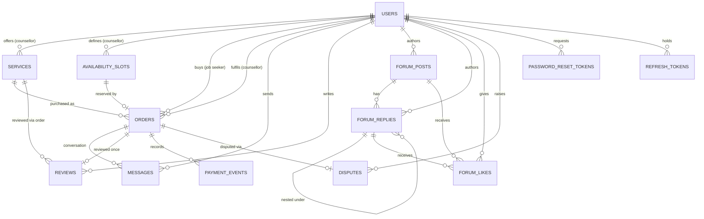

# Database Design Summary — YOIR

Condensed view of the database layer (13 tables) plus the reasoning behind it.

This revision closes the gaps found reviewing the first draft against the
baselined backlog. See [Changes in this revision](#changes-in-this-revision)
at the end for what moved and why.

## Schema



| Table | Purpose | Key fields |
|---|---|---|
| `users` | Accounts + both role profiles + counsellor verification, one wide table distinguished by `role` | email, role, bio, profile_visibility, base_state/city (counsellor), verification_status |
| `services` | Services a counsellor sells | title, price, duration, modality, location_state/city, is_active, avg_rating |
| `availability_slots` | A counsellor's bookable time slots | start_time, end_time, status, held_until |
| `orders` | Booking + payment, merged into one table | status, unit_price, payment_status, paid_amount, slot_id |
| `payment_events` | Raw provider webhook events, deduplicated | provider_event_id (unique), event_type, payload |
| `messages` | Buyer/counsellor chat tied to an order | order_id, sender_id, content |
| `reviews` | Post-completion rating and comment | order_id, service_id, counsellor_id, rating, comment |
| `disputes` | After-sales case raised against an order | order_id, reason, status, resolution_notes |
| `forum_posts` | Forum threads | category, tags, like_count |
| `forum_replies` | Replies to a post (supports nesting) | post_id, parent_reply_id |
| `forum_likes` | Who liked which post or reply | user_id + post_id/reply_id (unique) |
| `password_reset_tokens` | Single-use password reset links | token_hash, expires_at, used_at |
| `refresh_tokens` | Active sessions, so logout can invalidate one | token_hash, expires_at, revoked_at |

## Concurrency and integrity rules

These are the constraints the application must not be allowed to bypass. They
are stated first because three baselined requirements depend on them.

**Double-booking prevention — `US-41`, `NFR-06`**

`availability_slots.status` is display state: it decides what the app shows as
selectable. It is *not* the guarantee. Two concurrent checkouts can both read
`status = 'open'` before either writes. The guarantee is at the database:

```sql
-- One live order per slot. A cancelled or refunded order frees the slot again.
CREATE UNIQUE INDEX uniq_active_slot_order ON orders (slot_id)
  WHERE status NOT IN ('cancelled', 'refunded');
```

and the booking transaction takes a row lock before it checks availability:

```sql
BEGIN;
SELECT * FROM availability_slots WHERE id = :slot_id FOR UPDATE;
-- re-check status is 'open' or an expired 'held'
INSERT INTO orders (...);
UPDATE availability_slots SET status = 'held', held_until = now() + interval '15 minutes' WHERE id = :slot_id;
COMMIT;
```

The loser of a race fails on the unique index, not on a stale status read.
`held_until` lets an abandoned checkout release the slot without manual
cleanup — a `held` slot whose `held_until` has passed is treated as open.

**Payment idempotency — `R-05`**

`payment_events.provider_event_id` is `UNIQUE`. Every webhook is inserted
before it is acted on; a duplicate insert means the event was already
processed and the handler returns without re-applying it. Stripe retries
webhooks, so without this a retry double-applies the payment.

An order reaches `paid` **only** from a webhook, never from the client's
success callback.

**One review per order — `US-53`**

`UNIQUE (order_id)` on `reviews`.

**One like per user per target — `US-21`**

`UNIQUE (user_id, post_id)` and `UNIQUE (user_id, reply_id)` on `forum_likes`,
with a check that exactly one of `post_id` / `reply_id` is set. Unlike is a
delete of that row.

**No raw card data — `NFR-04`**

No table holds a card number, CVV or expiry. `orders` stores only provider
references (`payment_transaction_id`), and `payment_events.payload` stores the
provider's event body, which itself contains no full card number.

## Field reference

**`users`** — every account, job seeker or counsellor or admin, in one
table, distinguished by `role`.
- `email`, `password_hash` — login credentials
- `role` — job_seeker / counsellor / admin
- `bio`, `avatar_url` — profile basics
- `profile_visibility` — public / partial / restricted (`US-27`), enforced by
  the backend when serialising any other user's profile (`US-28`)
- `base_state`, `base_city`, `default_modality` — counsellor-only: where
  they're based, online/in-person/both
- `languages` — counsellor-only: languages spoken, searchable (client
  confirmed decision 3, 25 Aug)
- `verification_status`, `verification_linkedin_url` — counsellor-only:
  submitted LinkedIn link and its review state (pending/verified/rejected)
- `verification_reviewed_by`, `verification_reviewed_at`, `verification_notes`
  — the admin decision trail (`US-58`, `US-33`)
- `avg_rating`, `review_count` — counsellor-only: overall rating across all
  their services

**`services`** — one sellable offering from a counsellor, e.g. "Resume
Review" or "Mock Interview".
- `counsellor_id` — which counsellor owns it
- `title`, `description`, `category` — listing content
- `price`, `duration_minutes`, `modality` — price, length, online/in-person
- `location_state`, `location_city` — required when `modality` allows
  in-person; enforced by a table check constraint (`US-38`)
- `is_active`, `deleted_at` — soft delete. A service referenced by a past
  order is never hard-deleted, so historical orders stay intact (`US-36`)
- `avg_rating`, `review_count` — rating for this specific service (separate
  from the counsellor's overall rating)

**`availability_slots`** — bookable time blocks a counsellor has opened up.
- `counsellor_id` — whose calendar
- `start_time`, `end_time` — the block, stored as `timestamptz` so the
  confirmation can render a timezone (`US-68`)
- `status` — open / held / booked / cancelled
- `held_until` — when a `held` slot reverts to open if checkout never completes

**`orders`** — one booking-and-payment record.
- `job_seeker_id`, `counsellor_id`, `service_id`, `slot_id` — who bought
  what, from whom, for which slot
- `status` — pending_payment / paid / completed / cancelled / disputed /
  refunded
- `unit_price` — the service's price at the moment of booking (frozen even
  if the counsellor later changes the listed price)
- `rescheduled_from_slot_id`, `rescheduled_at`, `reschedule_count` — set when
  an eligible booking moves to another slot. The move is one transaction:
  claim the new slot, release the old one, update the order. On failure the
  transaction rolls back and the original booking survives (`US-69`)
- `payment_provider`, `payment_transaction_id`, `payment_status`,
  `paid_amount`, `paid_at` — payment detail, tracked separately from the
  order's own status

**`payment_events`** — one row per webhook received from the payment provider.
- `order_id` — which order the event concerns
- `provider_event_id` — the provider's own event id, `UNIQUE` (`R-05`)
- `event_type`, `payload`, `received_at`, `processed_at`

**`messages`** — chat between buyer and counsellor for one order.
- `order_id` — which order this thread belongs to
- `sender_id` — who sent it
- `content` — the message
- `read_at` — when the other party read it

**`reviews`** — the buyer's rating and comment after an order completes.
- `order_id` — which order, `UNIQUE` (one review per order)
- `service_id`, `counsellor_id`, `job_seeker_id` — denormalised from the
  order so the aggregate trigger can update both rating rollups without a join
- `rating` — 1–5
- `comment` — written feedback

**`disputes`** — an after-sales case raised against a purchased order.
- `order_id` — which order the case concerns (`US-51`)
- `raised_by` — the job seeker who opened it
- `reason`, `description` — what went wrong
- `status` — open / under_review / resolved / rejected
- `resolved_by`, `resolved_at`, `resolution_notes` — the Platform Owner's
  outcome (`US-52`)

**`forum_posts`** — a thread started by a job seeker.
- `author_id` — who posted
- `category`, `tags` — classification. `US-14` allows boards *or* categories,
  so a category field backs the board listing without a separate table
- `title`, `content` — the post itself
- `like_count`, `reply_count` — engagement counters, trigger-maintained

**`forum_replies`** — a reply to a post, nesting supported.
- `post_id` — which post this replies to
- `author_id` — who replied
- `parent_reply_id` — set when this is a reply to another reply, not
  directly to the post
- `content`, `like_count` — the reply text and its likes

**`forum_likes`** — one row per like, so a like can be undone (`US-21`).
- `user_id` — who liked it
- `post_id` *or* `reply_id` — exactly one is set
- Deleting the row is the unlike; the counter is trigger-maintained

**`password_reset_tokens`** — one row per reset request (`US-70`).
- `user_id`, `token_hash` — only the hash is stored, never the token itself
- `expires_at`, `used_at` — single-use and time-limited. Requesting a reset
  returns the same generic response whether or not the email exists, so the
  endpoint does not reveal account existence

**`refresh_tokens`** — active sessions, so logout can actually invalidate one
(`US-08`).
- `user_id`, `token_hash`, `expires_at`, `revoked_at`
- Access JWTs stay short-lived; logout revokes the refresh token, which stops
  the session being extended

## Counter maintenance

All denormalised counters are maintained by database triggers, not by the
application. Application-side increments race under concurrent writes, and
`US-54`, `US-55` and `US-21` all require the counts to stay consistent.

| Counter | Trigger fires on |
|---|---|
| `services.avg_rating`, `services.review_count` | insert/update/delete on `reviews`, matched on `service_id` |
| `users.avg_rating`, `users.review_count` | insert/update/delete on `reviews`, matched on `counsellor_id` |
| `forum_posts.like_count` | insert/delete on `forum_likes` where `post_id` is set |
| `forum_replies.like_count` | insert/delete on `forum_likes` where `reply_id` is set |
| `forum_posts.reply_count` | insert/delete on `forum_replies` |

## Data flow

For each major action, which table gets read and which gets written, in order.

**Register**
1. Insert into `users` (email, password_hash, role, display_name)
2. If role = counsellor: `verification_status` defaults to `pending`,
   `verification_linkedin_url` set from the submitted link

**Login**
1. Read `users` where `LOWER(email)` matches input (via `idx_users_email_lower`)
2. Check `password_hash`; on success, issue a short-lived access JWT carrying
   `id` and `role`, and insert a `refresh_tokens` row

**Logout** (`US-08`)
1. Update `refresh_tokens.revoked_at` for the presented refresh token
2. The access JWT expires on its own short TTL

**Reset a forgotten password** (`US-70`)
1. Read `users` by email. Respond identically whether or not it matched
2. If matched: insert `password_reset_tokens` (hash, `expires_at`), email the
   link
3. On submit: look up by hash, check `expires_at` and that `used_at` is null,
   update `users.password_hash`, set `used_at`, revoke all `refresh_tokens`

**Browse the marketplace**
1. Read `services` where `is_active`, filtered by category/price/modality
   (+ `location_state`/`location_city` when in-person, + counsellor
   `languages` when filtering by language)
2. Join to `users` on `services.counsellor_id` for the counsellor's
   `avg_rating`, `base_city`, `verification_status`, honouring that
   counsellor's `profile_visibility`

**Book a session**
1. Read `services.price`, `services.duration_minutes` for the chosen service
2. Read `availability_slots` where `status = 'open'`, or `status = 'held'`
   with `held_until` in the past, for that counsellor
3. Open a transaction and `SELECT … FOR UPDATE` the chosen slot row
4. Insert into `orders` (job_seeker_id, counsellor_id, service_id, slot_id,
   `unit_price` ← copied from `services.price`). The partial unique index on
   `orders.slot_id` rejects a concurrent second booking here
5. Update `availability_slots.status = 'held'`, `held_until = now() + 15 min`,
   and commit
6. On the payment webhook: insert `payment_events` (rejected if
   `provider_event_id` already exists), then update `orders.status = 'paid'`,
   `payment_status`, `paid_amount`, `paid_at`, and
   `availability_slots.status = 'booked'`
7. If no webhook arrives before `held_until`: the slot reverts to open and the
   order moves to `cancelled`. A failed or unknown payment never yields a
   confirmed booking

**Reschedule a booking** (`US-69`)
1. Read the order; confirm the requester is a participant and the booking is
   eligible
2. In one transaction: lock and claim the new slot, set
   `rescheduled_from_slot_id` to the old `slot_id`, point `slot_id` at the new
   slot, release the old slot to `open`, increment `reschedule_count`
3. Any failure rolls the whole transaction back, leaving the original booking
   intact

**Message within an order**
1. Read `orders.status` for the order — reject the send if it's
   `completed` or `cancelled` (`US-62`, `US-63`)
2. Insert into `messages` (order_id, sender_id, content)

**Leave a review**
1. Read `orders` to confirm `status = 'completed'` and the requester is
   `job_seeker_id` (`US-53`)
2. Insert into `reviews` (order_id, service_id, counsellor_id, job_seeker_id,
   rating, comment). `UNIQUE (order_id)` rejects a second review
3. Trigger fires automatically: updates `services.avg_rating`/`review_count`
   (matched on `service_id`) and `users.avg_rating`/`review_count`
   (matched on `counsellor_id`) — no separate write from the application

**Post / reply / like in the forum**
1. Insert into `forum_posts` (author_id, category, title, content) — app
   layer checks `users.role = 'job_seeker'` first (`US-19`)
2. Insert into `forum_replies` (post_id, author_id, content,
   `parent_reply_id` if replying to another reply)
3. Like: insert into `forum_likes`; unlike: delete that row. `like_count` and
   `reply_count` are updated by trigger, not by the application

**Raise an after-sales case** (`US-51`)
1. Read `orders` to confirm the requester is `job_seeker_id` and the order was
   paid
2. Insert into `disputes` (order_id, raised_by, reason, description)
3. Update `orders.status = 'disputed'`

**Resolve an after-sales case (admin)** (`US-52`)
1. Read `disputes` where `status = 'open'`
2. Update `disputes.status`, `resolved_by`, `resolved_at`, `resolution_notes`
3. Update the related `orders.status` to the agreed outcome

**Review a counsellor's verification (admin)**
1. Read `users` where `role = 'counsellor'` and `verification_status = 'pending'`
2. Update that row's `verification_status`, `verification_reviewed_by`,
   `verification_reviewed_at`, `verification_notes`

## Accepted deviations from the baseline

Recorded here because `NFR-07` requires deviations to stay traceable.

| Decision | Baseline wording | Why |
|---|---|---|
| No separate `conversations` table — `messages` hang directly off `orders` | `US-49` describes a conversation created on order creation | One order is always exactly one conversation, so the join table adds nothing. Closure is derived from `orders.status`, which satisfies `US-62`/`US-63` |
| `forum_posts.category` instead of a `forum_boards` table | `US-14` says "boards or categories" | Explicitly permitted by the story |
| One wide `users` table for all three roles | — | Counsellor-only columns are nullable and not enforced by the database. Accepted for MVP speed; role-correctness is enforced in the service layer |
| Reschedule keeps only the immediately previous slot | `US-69` | Full reschedule history would need an audit table. `reschedule_count` plus the previous slot is enough for the story's acceptance criteria |

## Schema management

The schema is versioned with Alembic migrations in the backend repository.
Every change is a reviewed migration committed alongside the code that needs
it — the database is never altered by hand, and this document is updated in
the same pull request so the two cannot drift.

## Changes in this revision

Applied after reviewing the first draft against the baselined backlog.

**Correctness**
- Double-booking is now enforced by a partial unique index on `orders.slot_id`
  plus a row lock, not by the mutable `availability_slots.status` field, which
  did not prevent concurrent bookings (`US-41`, `NFR-06`)

**Tables added for Must-have stories**
- `disputes` — `US-51`, `US-52` had no case record at all
- `forum_likes` — `US-21` needs per-user like rows to support unlike
- `password_reset_tokens` — `US-70`
- `refresh_tokens` — `US-08` logout could not invalidate a stateless JWT
- `payment_events` — webhook idempotency, `R-05`

**Fields added**
- `users.profile_visibility` (`US-27`, `US-28`), `users.languages` (client
  confirmed decision 3)
- `services.location_state`/`location_city` (`US-38`) — used by the browse
  flow in the draft but missing from the schema
- `services.is_active`/`deleted_at` (`US-36`) — soft delete so historical
  orders survive
- `availability_slots.held_until` — expiring holds
- `orders.rescheduled_from_slot_id`, `rescheduled_at`, `reschedule_count`
  (`US-69`)
- `reviews.service_id`, `counsellor_id`, `job_seeker_id` — the draft's
  aggregate trigger needed these but the field list omitted them

**Consistency**
- `availability_slots.start_time`/`end_time` are `timestamptz` (`US-68`)
- All counters are trigger-maintained. The draft used a trigger for review
  aggregates but application increments for forum counters, which races
- Schema management is Alembic migrations, replacing the draft's note about
  applying changes to a local database by hand
