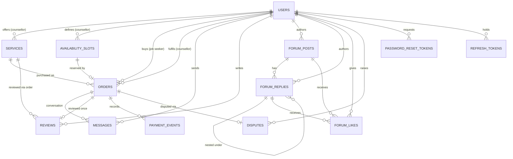

# Database Design Summary — YOIR

Condensed view of the database layer plus the reasoning behind it.

**Updated 8 October 2026.** The design further down was written in Sprint 1 (13
tables). The build on `dev` has nine tables (Alembic revisions `0001`–`0008`) and
differs from the design in places, most importantly in how double-booking is
prevented. [Schema as built](#schema-as-built) lists the tables in code and gives
the status of every designed table. The concurrency rules and the booking data
flow describe the built mechanism; the other sections keep the Sprint 1 design
for tables that are planned or deferred. See
[Changes on 8 October 2026](#changes-on-8-october-2026) for what moved and why.

**Updated 18 October 2026, end of Sprint 3.** The build on `dev` now has eleven tables (Alembic revisions `0001`–`0012`). Sprint 3 added `diagnoses` (`0009`, US-09–US-13) and `reviews` (`0010`, US-53–US-55), and froze the service title (`0011`) and the in-person meeting area (`0012`) on `orders` so a purchase keeps what was bought (US-36). Reschedule (US-69) is built on the existing tables. The tables and statuses below are current at 18 October.

## Schema as built

| Table | Purpose | Key fields |
|---|---|---|
| `users` | Every account in one wide table distinguished by `role`, with the Career Professional's profile, verification and Stripe Connect fields | email (unique), password_hash, role, email_verified_at, sessions_invalidated_at, profile_visibility, photo_url, qualifications / expertise / languages (JSON), base_location_state/city, default_modality, verification_status, overall_rating, review_count, stripe_account_id, payouts_enabled, abn, gst_registered |
| `services` | Services a Career Professional sells | counsellor_id, title, description, price_minor, currency, duration_minutes, modalities (JSON), location_state/city, meeting_url, active, average_rating, review_count |
| `availability_windows` | Spans of a Career Professional's time open for booking | counsellor_id, starts_at, ends_at, modalities |
| `orders` | A checkout: the held time and the amount split, frozen at booking | job_seeker_id, service_id, window_id, starts_at, ends_at, status, payment_status, hold_expires_at, payment_intent_id (unique), amount_minor, platform_fee_minor, counsellor_payout_minor, pre_session_brief, service_title, meeting_area |
| `diagnoses` | One Yoir Diagnosis per Job Seeker | job_seeker_id (unique), questionnaire_version, answers (JSON), revision, created_at, updated_at |
| `reviews` | A buyer's rating and comment for a completed session | booking_id (unique), order_id, service_id, counsellor_id, job_seeker_id, rating, comment, created_at |
| `bookings` | A confirmed session, created from a paid order | order_id (unique), service_id, window_id, job_seeker_id, counsellor_id, starts_at, ends_at, status, meeting_url, meeting_address, transfer_id (unique), refunded_minor, flagged_for_review |
| `processed_webhook_events` | Stripe webhook events already handled | event_id (primary key), event_type, processed_at |
| `refresh_tokens` | Refresh tokens, rotated on every use | token_digest (primary key), family_id, user_id, expires_at, used_at, revoked_at |
| `single_use_tokens` | Email-verification and password-reset links | token_digest (primary key), user_id, purpose, expires_at, used_at |
| `revoked_tokens` | Access tokens revoked at logout | token_digest (primary key), expires_at, revoked_at |

| Sprint 1 design | Status on 18 October 2026 |
|---|---|
| `users` | Built, with profile, verification and Stripe Connect fields added |
| `services` | Built. Prices are in minor units; a `modalities` list replaces `modality` |
| `availability_slots` | Replaced by `availability_windows`; bookable times are derived |
| `orders` | Built, split into `orders` (the checkout) and `bookings` (the confirmed session) |
| `payment_events` | Replaced by `processed_webhook_events`; the PaymentIntent id lives on `orders` |
| `password_reset_tokens` | Built as `single_use_tokens`, which also holds email-verification links |
| `refresh_tokens` | Built; `revoked_tokens` added for access tokens revoked at logout |
| `reviews` | Built in Sprint 3 (`0010_reviews`, US-53–US-55). One review per booking (`UNIQUE (booking_id)`) rather than per order. The service and Career Professional ratings are recomputed in application code (`backend/app/reviews.py`) on each review, not by a database trigger |
| `messages` | Deferred (Requirements RR-08) |
| `disputes` | Deferred (RR-08). A Stripe chargeback flags the booking for Platform Owner review instead (`bookings.flagged_for_review`) |
| `forum_posts`, `forum_replies`, `forum_likes` | Deferred (RR-08) |
| Diagnosis answers (not in the Sprint 1 design) | Built as `diagnoses` (`0009_diagnosis_progress`, PR #233): one record per Job Seeker with versioned answers and a revision number that rejects a stale save. The direction and Explore criteria (US-12, US-13) are computed from it and not stored |

## Schema as designed in Sprint 1



| Table | Purpose | Key fields |
|---|---|---|
| `users` | Accounts + both role profiles + counsellor verification, one wide table distinguished by `role` | email, role, bio, profile_visibility, base_state/city (counsellor), verification_status |
| `services` | Services a counsellor sells | title, price, duration, modality, location_state/city, is_active, avg_rating |
| `availability_slots` | A counsellor's bookable time slots | start_time, end_time, status, held_until |
| `orders` | Booking + payment, merged into one table | status, unit_price, payment_status, paid_amount, slot_id |
| `payment_events` | Raw provider webhook events, deduplicated | provider_event_id (unique), event_type, payload |
| `messages` | Buyer/counsellor chat tied to an order | order_id, sender_id, content |
| `reviews` | Post-completion rating and comment | order_id, service_id, counsellor_id, rating, comment |
| `disputes` | After-sales case raised against an order | order_id, reason, status, resolution_notes |
| `forum_posts` | Forum threads | category, tags, like_count |
| `forum_replies` | Replies to a post (supports nesting) | post_id, parent_reply_id |
| `forum_likes` | Who liked which post or reply | user_id + post_id/reply_id (unique) |
| `password_reset_tokens` | Single-use password reset links | token_hash, expires_at, used_at |
| `refresh_tokens` | Active sessions, so logout can invalidate one | token_hash, expires_at, revoked_at |

## Concurrency and integrity rules

These are the constraints the application must not be allowed to bypass. They
are stated first because three baselined requirements depend on them.

**Double-booking prevention — `US-41`, `NFR-06`** (as built)

Availability is stored as `availability_windows`, and the bookable times inside
a window are derived (`app/availability.py`), so there is no slot row to lock or
index. A time is taken while a live booking covers it, or while an unpaid order
covers it and its `hold_expires_at` is still in the future. The booking
transaction serialises on the Career Professional instead:

```sql
BEGIN;
SELECT * FROM users WHERE id = :counsellor_id FOR UPDATE;
-- a window must cover [starts_at, ends_at) and allow the chosen modality;
-- no live booking, and no awaiting_payment order with an unexpired hold,
-- may overlap [starts_at, ends_at)
INSERT INTO orders (..., status, hold_expires_at)
  VALUES (..., 'awaiting_payment', now() + interval '15 minutes');
COMMIT;
```

Every booking attempt on one calendar runs one at a time, so the loser of a race
sees the winner's order and gets `409 SLOT_UNAVAILABLE`.
`test_postgresql_concurrent_order_requests_reserve_slot_once` proves this against
PostgreSQL. A lapsed hold frees its time without any clean-up, because an expired
`hold_expires_at` no longer counts; a periodic job then cancels the order and its
PaymentIntent.

**Known gap.** The guarantee depends on the application taking the lock; the
database has no constraint against two overlapping live orders. The Sprint 1
partial unique index on `orders.slot_id` no longer fits, because a window is a
span rather than a row. The planned fix is an `EXCLUDE` constraint over the
booked time range (`tstzrange(starts_at, ends_at)` with `btree_gist`). Until it
exists, the strict expected-failure test
`test_orders_have_a_database_invariant_against_overlapping_holds` keeps the gap
visible.

**Payment idempotency — `R-05`**

`processed_webhook_events.event_id` is the primary key. Every webhook is
inserted before it is acted on; a duplicate insert means the event was already
processed and the handler returns without re-applying it. Stripe retries
webhooks, so without this a retry double-applies the payment.

An order reaches `confirmed` **only** from a signed webhook (or, in a deployment
without Stripe keys, the labelled stub endpoint), never from the client's
success callback. If the hold lapsed and another booking took the time, the
order becomes `refunded_slot_taken` and the payment is refunded.

**One review per order — `US-53`**

`UNIQUE (order_id)` on `reviews`.

**One like per user per target — `US-21`**

`UNIQUE (user_id, post_id)` and `UNIQUE (user_id, reply_id)` on `forum_likes`,
with a check that exactly one of `post_id` / `reply_id` is set. Unlike is a
delete of that row.

**No raw card data — `NFR-04`**

No table holds a card number, CVV or expiry. `orders` stores only the Stripe
PaymentIntent id, `bookings` only the Connect transfer id, and
`processed_webhook_events` only the event id and type.

## Field reference

**`users`** — every account, job seeker or counsellor or admin, in one
table, distinguished by `role`.
- `email`, `password_hash` — login credentials
- `role` — job_seeker / counsellor / admin
- `bio`, `avatar_url` — profile basics
- `profile_visibility` — public / partial / restricted (`US-27`), enforced by
  the backend when serialising any other user's profile (`US-28`)
- `base_state`, `base_city`, `default_modality` — counsellor-only: where
  they're based, online/in-person/both
- `languages` — counsellor-only: languages spoken, searchable (client
  confirmed decision 3, 25 Aug)
- `verification_status`, `verification_linkedin_url` — counsellor-only:
  submitted LinkedIn link and its review state (pending/verified/rejected)
- `verification_reviewed_by`, `verification_reviewed_at`, `verification_notes`
  — the admin decision trail (`US-58`, `US-33`)
- `avg_rating`, `review_count` — counsellor-only: overall rating across all
  their services

**`services`** — one sellable offering from a counsellor, e.g. "Resume
Review" or "Mock Interview".
- `counsellor_id` — which counsellor owns it
- `title`, `description`, `category` — listing content
- `price`, `duration_minutes`, `modality` — price, length, online/in-person
- `location_state`, `location_city` — required when `modality` allows
  in-person; enforced by a table check constraint (`US-38`)
- `is_active`, `deleted_at` — soft delete. A service referenced by a past
  order is never hard-deleted, so historical orders stay intact (`US-36`)
- `avg_rating`, `review_count` — rating for this specific service (separate
  from the counsellor's overall rating)

**`availability_slots`** — bookable time blocks a counsellor has opened up.
- `counsellor_id` — whose calendar
- `start_time`, `end_time` — the block, stored as `timestamptz` so the
  confirmation can render a timezone (`US-68`)
- `status` — open / held / booked / cancelled
- `held_until` — when a `held` slot reverts to open if checkout never completes

**`orders`** — one booking-and-payment record.
- `job_seeker_id`, `counsellor_id`, `service_id`, `slot_id` — who bought
  what, from whom, for which slot
- `status` — pending_payment / paid / completed / cancelled / disputed /
  refunded
- `unit_price` — the service's price at the moment of booking (frozen even
  if the counsellor later changes the listed price)
- `rescheduled_from_slot_id`, `rescheduled_at`, `reschedule_count` — set when
  an eligible booking moves to another slot. The move is one transaction:
  claim the new slot, release the old one, update the order. On failure the
  transaction rolls back and the original booking survives (`US-69`)
- `payment_provider`, `payment_transaction_id`, `payment_status`,
  `paid_amount`, `paid_at` — payment detail, tracked separately from the
  order's own status

**`payment_events`** — one row per webhook received from the payment provider.
- `order_id` — which order the event concerns
- `provider_event_id` — the provider's own event id, `UNIQUE` (`R-05`)
- `event_type`, `payload`, `received_at`, `processed_at`

**`messages`** — chat between buyer and counsellor for one order.
- `order_id` — which order this thread belongs to
- `sender_id` — who sent it
- `content` — the message
- `read_at` — when the other party read it

**`reviews`** — the buyer's rating and comment after an order completes.
- `order_id` — which order, `UNIQUE` (one review per order)
- `service_id`, `counsellor_id`, `job_seeker_id` — denormalised from the
  order so the aggregate trigger can update both rating rollups without a join
- `rating` — 1–5
- `comment` — written feedback

**`disputes`** — an after-sales case raised against a purchased order.
- `order_id` — which order the case concerns (`US-51`)
- `raised_by` — the job seeker who opened it
- `reason`, `description` — what went wrong
- `status` — open / under_review / resolved / rejected
- `resolved_by`, `resolved_at`, `resolution_notes` — the Platform Owner's
  outcome (`US-52`)

**`forum_posts`** — a thread started by a job seeker.
- `author_id` — who posted
- `category`, `tags` — classification. `US-14` allows boards *or* categories,
  so a category field backs the board listing without a separate table
- `title`, `content` — the post itself
- `like_count`, `reply_count` — engagement counters, trigger-maintained

**`forum_replies`** — a reply to a post, nesting supported.
- `post_id` — which post this replies to
- `author_id` — who replied
- `parent_reply_id` — set when this is a reply to another reply, not
  directly to the post
- `content`, `like_count` — the reply text and its likes

**`forum_likes`** — one row per like, so a like can be undone (`US-21`).
- `user_id` — who liked it
- `post_id` *or* `reply_id` — exactly one is set
- Deleting the row is the unlike; the counter is trigger-maintained

**`password_reset_tokens`** — one row per reset request (`US-70`).
- `user_id`, `token_hash` — only the hash is stored, never the token itself
- `expires_at`, `used_at` — single-use and time-limited. Requesting a reset
  returns the same generic response whether or not the email exists, so the
  endpoint does not reveal account existence

**`refresh_tokens`** — active sessions, so logout can actually invalidate one
(`US-08`).
- `user_id`, `token_hash`, `expires_at`, `revoked_at`
- Access JWTs stay short-lived; logout revokes the refresh token, which stops
  the session being extended

## Counter maintenance

All denormalised counters are maintained by database triggers, not by the
application. Application-side increments race under concurrent writes, and
`US-54`, `US-55` and `US-21` all require the counts to stay consistent.

| Counter | Trigger fires on |
|---|---|
| `services.avg_rating`, `services.review_count` | insert/update/delete on `reviews`, matched on `service_id` |
| `users.avg_rating`, `users.review_count` | insert/update/delete on `reviews`, matched on `counsellor_id` |
| `forum_posts.like_count` | insert/delete on `forum_likes` where `post_id` is set |
| `forum_replies.like_count` | insert/delete on `forum_likes` where `reply_id` is set |
| `forum_posts.reply_count` | insert/delete on `forum_replies` |

## Data flow

For each major action, which table gets read and which gets written, in order.

**Register**
1. Insert into `users` (email, password_hash, role, display_name)
2. If role = counsellor: `verification_status` defaults to `pending`,
   `verification_linkedin_url` set from the submitted link

**Login**
1. Read `users` where `LOWER(email)` matches input (via `idx_users_email_lower`)
2. Check `password_hash`; on success, issue a short-lived access JWT carrying
   `id` and `role`, and insert a `refresh_tokens` row

**Logout** (`US-08`)
1. Update `refresh_tokens.revoked_at` for the presented refresh token
2. The access JWT expires on its own short TTL

**Reset a forgotten password** (`US-70`)
1. Read `users` by email. Respond identically whether or not it matched
2. If matched: insert `password_reset_tokens` (hash, `expires_at`), email the
   link
3. On submit: look up by hash, check `expires_at` and that `used_at` is null,
   update `users.password_hash`, set `used_at`, revoke all `refresh_tokens`

**Browse the marketplace**
1. Read `services` where `is_active`, filtered by category/price/modality
   (+ `location_state`/`location_city` when in-person, + counsellor
   `languages` when filtering by language)
2. Join to `users` on `services.counsellor_id` for the counsellor's
   `avg_rating`, `base_city`, `verification_status`, honouring that
   counsellor's `profile_visibility`

**Book a session** (as built)
1. Read `services.price_minor` and `services.duration_minutes` for the chosen
   service; the price is never taken from the request
2. Open a transaction and `SELECT … FOR UPDATE` the Career Professional's
   `users` row
3. Check that an `availability_windows` row covers the time and allows the
   modality, and that no live booking or unexpired hold overlaps it
4. Insert into `orders` (job_seeker_id, service_id, window_id, starts_at,
   ends_at, the frozen amount split, `status = 'awaiting_payment'`,
   `hold_expires_at = now() + 15 min`) and commit
5. Create a Stripe PaymentIntent and store `orders.payment_intent_id`
6. On the signed `payment_intent.succeeded` webhook: insert
   `processed_webhook_events` (rejected if `event_id` already exists), re-check
   the time, set `orders.status = 'confirmed'` and insert `bookings` with its
   meeting link
7. If the hold lapses unpaid, a periodic job sets `orders.status = 'cancelled'`
   and cancels the PaymentIntent. A failed or unknown payment never yields a
   confirmed booking

**Reschedule a booking** (`US-69`, planned; to be re-specified against
availability windows and the row lock above)

*As built in Sprint 3:* `POST /bookings/{bookingId}/reschedule` locks the booking row, then the Career Professional's row (the same lock as booking), checks the new time against the availability windows and the other bookings, and moves the same order and booking in place in one transaction. No new order is created and no payment is retaken; a time taken by someone else returns `SLOT_UNAVAILABLE` and the original booking is unchanged. The Sprint 1 steps below assumed slot rows, which the build replaced with availability windows.

1. Read the order; confirm the requester is a participant and the booking is
   eligible
2. In one transaction: lock and claim the new slot, set
   `rescheduled_from_slot_id` to the old `slot_id`, point `slot_id` at the new
   slot, release the old slot to `open`, increment `reschedule_count`
3. Any failure rolls the whole transaction back, leaving the original booking
   intact

**Message within an order**
1. Read `orders.status` for the order — reject the send if it's
   `completed` or `cancelled` (`US-62`, `US-63`)
2. Insert into `messages` (order_id, sender_id, content)

**Leave a review**
1. Read `orders` to confirm `status = 'completed'` and the requester is
   `job_seeker_id` (`US-53`)
2. Insert into `reviews` (order_id, service_id, counsellor_id, job_seeker_id,
   rating, comment). `UNIQUE (order_id)` rejects a second review
3. Trigger fires automatically: updates `services.avg_rating`/`review_count`
   (matched on `service_id`) and `users.avg_rating`/`review_count`
   (matched on `counsellor_id`) — no separate write from the application

*As built in Sprint 3:* the review is accepted only from the buyer of a completed or paid-out booking, `UNIQUE (booking_id)` rejects a second review, and the application recomputes both ratings in the same transaction instead of a trigger.

**Post / reply / like in the forum**
1. Insert into `forum_posts` (author_id, category, title, content) — app
   layer checks `users.role = 'job_seeker'` first (`US-19`)
2. Insert into `forum_replies` (post_id, author_id, content,
   `parent_reply_id` if replying to another reply)
3. Like: insert into `forum_likes`; unlike: delete that row. `like_count` and
   `reply_count` are updated by trigger, not by the application

**Raise an after-sales case** (`US-51`)
1. Read `orders` to confirm the requester is `job_seeker_id` and the order was
   paid
2. Insert into `disputes` (order_id, raised_by, reason, description)
3. Update `orders.status = 'disputed'`

**Resolve an after-sales case (admin)** (`US-52`)
1. Read `disputes` where `status = 'open'`
2. Update `disputes.status`, `resolved_by`, `resolved_at`, `resolution_notes`
3. Update the related `orders.status` to the agreed outcome

**Review a counsellor's verification (admin)**
1. Read `users` where `role = 'counsellor'` and `verification_status = 'pending'`
2. Update that row's `verification_status`, `verification_reviewed_by`,
   `verification_reviewed_at`, `verification_notes`

## Accepted deviations from the baseline

Recorded here because `NFR-07` requires deviations to stay traceable.

| Decision | Baseline wording | Why |
|---|---|---|
| No separate `conversations` table — `messages` hang directly off `orders` | `US-49` describes a conversation created on order creation | One order is always exactly one conversation, so the join table adds nothing. Closure is derived from `orders.status`, which satisfies `US-62`/`US-63` |
| `forum_posts.category` instead of a `forum_boards` table | `US-14` says "boards or categories" | Explicitly permitted by the story |
| One wide `users` table for all three roles | — | Counsellor-only columns are nullable and not enforced by the database. Accepted for MVP speed; role-correctness is enforced in the service layer |
| Reschedule keeps only the immediately previous slot | `US-69` | Full reschedule history would need an audit table. `reschedule_count` plus the previous slot is enough for the story's acceptance criteria |

## Schema management

The schema is versioned with Alembic migrations in the backend repository.
Every change is a reviewed migration committed alongside the code that needs
it — the database is never altered by hand, and this document is updated in
the same pull request so the two cannot drift.

## Changes on 8 October 2026

Brought in line with the schema on `dev`.

- Added [Schema as built](#schema-as-built) and the status of every designed
  table.
- Double-booking: the slot-based unique index was replaced in the build by a
  lock on the Career Professional's row, because availability is now stored as
  windows. The missing database constraint is recorded as a known gap.
- Payment idempotency now uses `processed_webhook_events`, and an order is
  confirmed from the signed Stripe webhook.
- The booking data flow describes the built steps; reschedule is marked
  planned.

## Changes in the Sprint 1 revision

Applied after reviewing the first draft against the baselined backlog.

**Correctness**
- Double-booking is now enforced by a partial unique index on `orders.slot_id`
  plus a row lock, not by the mutable `availability_slots.status` field, which
  did not prevent concurrent bookings (`US-41`, `NFR-06`)

**Tables added for Must-have stories**
- `disputes` — `US-51`, `US-52` had no case record at all
- `forum_likes` — `US-21` needs per-user like rows to support unlike
- `password_reset_tokens` — `US-70`
- `refresh_tokens` — `US-08` logout could not invalidate a stateless JWT
- `payment_events` — webhook idempotency, `R-05`

**Fields added**
- `users.profile_visibility` (`US-27`, `US-28`), `users.languages` (client
  confirmed decision 3)
- `services.location_state`/`location_city` (`US-38`) — used by the browse
  flow in the draft but missing from the schema
- `services.is_active`/`deleted_at` (`US-36`) — soft delete so historical
  orders survive
- `availability_slots.held_until` — expiring holds
- `orders.rescheduled_from_slot_id`, `rescheduled_at`, `reschedule_count`
  (`US-69`)
- `reviews.service_id`, `counsellor_id`, `job_seeker_id` — the draft's
  aggregate trigger needed these but the field list omitted them

**Consistency**
- `availability_slots.start_time`/`end_time` are `timestamptz` (`US-68`)
- All counters are trigger-maintained. The draft used a trigger for review
  aggregates but application increments for forum counters, which races
- Schema management is Alembic migrations, replacing the draft's note about
  applying changes to a local database by hand
