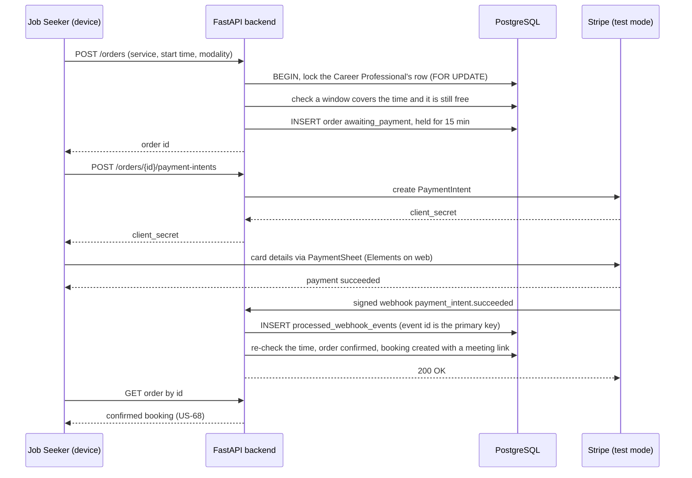
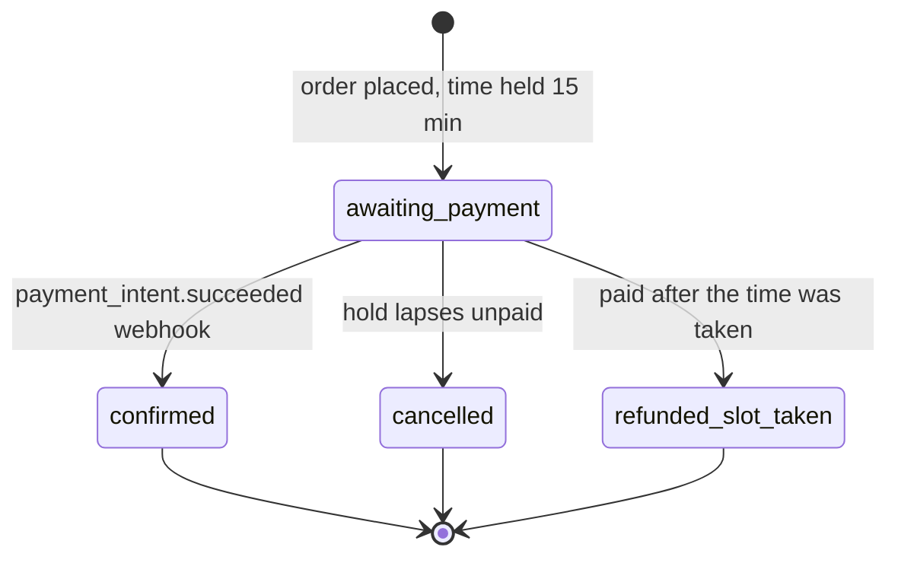
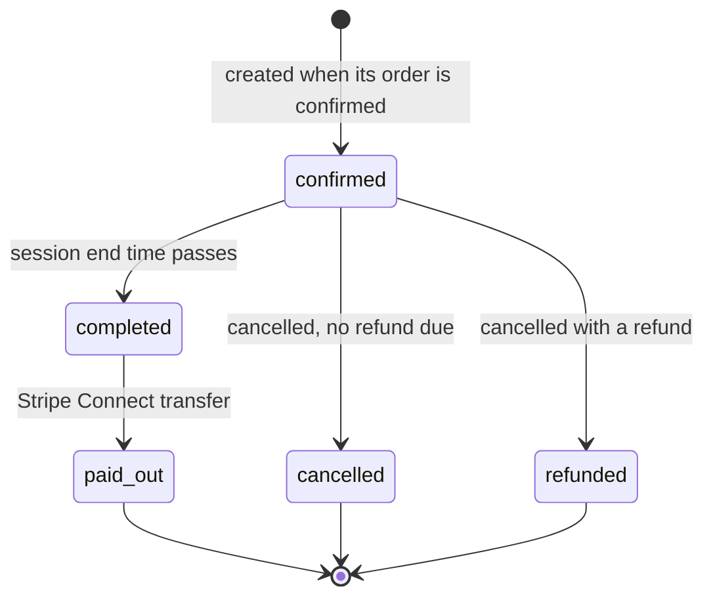

# Design by Concept: Yoir

Team CSD-Koala · SWEN90014 Semester 2, 2026 · First written in Sprint 1 · Updated 8 October 2026 to match the build

This document explains the architecture drawn in
[`design-by-concept.drawio`](design-by-concept.drawio)
(rendered as [`design-by-concept.png`](design-by-concept.png)):
what each layer is, why each technology was chosen, and how the structure
satisfies the baselined requirements.

The diagram shows the structure. This document carries the reasoning, so the
two should be read together and changed together.

---

## 0. What changed since Sprint 1

This page was written for the Sprint 1 executable architecture. On 8 October 2026
it was brought in line with the build on `dev` (code at commit `4f579d3`), which
carries the Sprint 2 release and the first Sprint 3 work. The diagram marks every
component with a status:

- **Built** (solid box): in code and working end to end.
- **In progress** (dashed amber box): in the active backlog, not finished.
- **Deferred** (grey box): outside the active 43-story scope
  ([Requirements](https://github.com/swen90014-2026-sm2/SWEN90014-2026-CSD-Koala/wiki/Requirements), RR-08).
- **Payment path** (purple box): built components on the Stripe path.

| Area | Sprint 1 design | Built |
|---|---|---|
| Hosting | Render / Fly.io container, managed PostgreSQL | FastAPI Cloud for the API and the Expo web export; Neon PostgreSQL; deployed on every merge to `dev` |
| Payments | A mock by default; Stripe test mode only if `CLIENT-02` required a real provider | Stripe test mode: PaymentIntents, PaymentSheet on iOS and Android, Elements on the web build, signed webhooks and Stripe Connect payouts. A labelled stub endpoint stands in when no keys are set |
| Availability | One row per bookable slot | Availability windows; the bookable times inside a window are derived |
| Double-booking | A partial unique index on `orders.slot_id` plus a slot row lock | A lock on the Career Professional's row inside the booking transaction (§4) |
| Email | Provider not selected | Mailgun; messages are logged instead when no key is set |
| Meeting links | A Zoom or Meet link stored on the booking | A Jitsi Meet room per booking, or the Career Professional's own Zoom / Meet link |
| Scope | 51 baselined stories, including Forum, messaging and disputes | 43 active stories; Forum, messaging and disputes are deferred |

---

## 1. What the requirements already fix

These were settled before any technology choice, and they constrain everything
below.

| Source | Constraint |
|---|---|
| `CLIENT-04`, 25 Aug 2026 | The client is an **installable mobile app**, one Expo / React Native codebase. **Both iOS and Android are in scope** (Requirements RR-04, 27 Aug). The same codebase also exports a web build, which the backend serves for demonstrations only. |
| `CLIENT-03`, confirmed 25 Aug 2026 | English-only interface. No language selector, no saved language preference. |
| `CLIENT-02` | Payments run through **Stripe in test mode**; no real money moves this semester (Requirements RR-03). Live payouts and automated refunds are deferred. |
| Baseline §7.2 | A separate browser-based web client is **out of scope** unless approved through change control. |
| Baseline §7.2 | App Store / Play publication is out of scope. Test builds are distributed through TestFlight and Play internal testing. |
| Baseline §6.2 | Access control is enforced **server-side only**. The client may hide an action; it may not be the thing that prevents it. |
| Project Background §6.3 | The client imposed no stack. The team picks technologies it knows and that are well supported, with **team familiarity as the deciding factor**. |

Two further facts shaped the choice: the handover repository contains an
untouched Expo (React Native) scaffold with no product code, and the team has
two frontend developers, two backend developers and one QA lead for roughly
seven weeks of feature delivery across Sprints 2 and 3. The Sprint 1 baseline had
51 stories (179 SP); the active scope is now 43 stories (Requirements RR-08).

---

## 2. Technology stack

This table is the runtime view of the outcome; the alternatives considered are
recorded in §7. What the team reuses and what it builds is in §8.

| Layer | Choice |
|---|---|
| Mobile client | React Native 0.86 + Expo SDK 57, TypeScript, `expo-router` |
| Build and distribution | iOS and Android from one codebase. EAS Build and TestFlight / Play internal testing are planned; there is no EAS configuration yet. The backend serves the Expo web export for demonstrations |
| Backend | FastAPI (Python 3.12), Pydantic v2, SQLAlchemy 2.0 with psycopg2, Alembic |
| Web server | Uvicorn (ASGI), run by FastAPI Cloud |
| Database | PostgreSQL 16 locally and in CI; Neon (managed PostgreSQL) in the cloud |
| Authentication | JWT access tokens + rotating refresh tokens, Argon2id password hashing, single-use tokens for email verification and password reset |
| Payments | Stripe test mode: PaymentIntents, PaymentSheet on iOS and Android, Stripe Elements on the web build, signed webhooks and Stripe Connect payouts. A labelled stub endpoint stands in when no keys are set |
| Email | Mailgun; messages are logged instead when no key is set |
| API contract | REST/JSON under `/api/v1`; OpenAPI published as `openapi.yaml` and checked against the traceability file in CI; hand-written typed TypeScript client |
| Hosting | FastAPI Cloud (API and web export) + Neon PostgreSQL, deployed on every merge to `dev` |
| CI | GitHub Actions: Ruff, pytest on PostgreSQL with coverage, live HTTPX journeys, `tsc`, ESLint, Jest, Playwright Chromium acceptance, and iOS and Android component suites |

### What the client choice means at runtime

One codebase, not two: with two frontend developers and seven weeks, writing
every story twice is not deliverable, and one Expo codebase serves both iOS and
Android. The runtime consequences that matter to this document:

- **EAS Build** (planned) produces signed builds in the cloud, so not every
  developer needs a Mac to build for iOS.
- **`expo-updates`** is not used yet, so a JavaScript-only fix still needs a new
  build of the app.
- The Stripe native module (`@stripe/stripe-react-native`) means Expo Go cannot
  run the payment flow; it needs a development build. The web build uses Stripe
  Elements instead.

### What the backend choice means at runtime

The load-bearing property is the **published OpenAPI schema**. `openapi.yaml`
lists every operation with its requirement IDs, and CI checks it against the
interface traceability file, so contract drift fails the build. The TypeScript
client is still written by hand against it; generating it with
`openapi-typescript` is planned. The in-memory demo API that let the front end
start before the back end existed has been removed, so every screen now talks to
the real API. At two developers per side, that shared contract is worth more than
raw framework performance.

Pydantic v2 validates requests and responses at the edge; Alembic gives
versioned, reviewable schema migrations.

---

## 3. Runtime structure

The same left-to-right layers as the concept diagram (actors, client, server,
database), with the external services as a band beneath them.

### Actors

Four roles, matching baseline §4.1 plus the unauthenticated visitor:
**Visitor**, **Job Seeker**, **Career Professional** (role value `counsellor`),
**Platform Owner**.

The Visitor is first-class because baseline §6.1 makes public browsing a
requirement, not an afterthought: Explore listings, service detail and Career
Professional profiles are readable without an account. The Forum is deferred.

### Front end: on the device

A single Expo application, screens grouped by the role that reaches them.
`expo-router` provides file-based routing and the role gate. Screens name the
story they implement (23 of the 36 route files on 8 October), which gives QA a
traceability hook for `NFR-07`.

The **Platform Owner screens live inside the same app**, role-gated, rather
than in a separate web console. Baseline §7.2 excludes a browser-based web
client without change control, and the verification queue and the payments,
bookings and user lists are list-and-approve interactions that work acceptably on
a phone. The demo web build shows the same screens but is not a supported client.

### Backend: in the cloud

Uvicorn serves the FastAPI application on FastAPI Cloud. Inside:

- **REST endpoints**: the HTTP surface, one router per capability area (ten
  routers).
- **Domain logic**: availability, payments, meetings and mail live in their own
  modules so they can be tested without HTTP. The order and booking rules still
  sit in the routers; moving them out is planned.
- **Cross-cutting concerns**: RBAC dependency guards, Pydantic validation,
  Alembic migrations applied at startup, the published OpenAPI schema,
  standard-library logging, and an in-process periodic job that releases lapsed
  holds, completes sessions and pays Career Professionals.
- **Data models**: SQLAlchemy 2.0 mappings for nine tables. The as-built tables
  and the design are in
  [`database-schema.md`](database-schema.md).

The frontend may hide unavailable actions, but per baseline §6.2 the backend
remains solely responsible for enforcing roles, resource ownership and the
protection of private data. Every guard is server-side.

### Database

PostgreSQL (Neon in the cloud) is the single source of truth, including for
concurrency control; see §4.

### External services

| Service | Role at runtime |
|---|---|
| **Stripe** (test mode) | PaymentSheet on iOS and Android, and Elements on the web build, take card details directly. The backend creates PaymentIntents, receives signed webhooks and pays Career Professionals through Stripe Connect transfers |
| **Object storage** | Not integrated. A profile photo is a URL or, for a Job Seeker, an inline data URI on the user row; services have no images yet |
| **Transactional email** (Mailgun) | Email verification, password reset (`US-70`), booking confirmations to both participants and verification decisions; backend only. Without an API key, messages are logged instead |
| **LinkedIn** (`CLIENT-01`) | A submitted URL, opened manually by the Platform Owner, with no runtime API dependency |
| **Meeting link** | A Jitsi Meet room created when a booking is confirmed, or the Career Professional's own Zoom / Meet link set on the service (`US-43`); video is not built in |
| **EAS Build + test tracks** | Planned; build-time only, not a runtime dependency |

Stripe is the one external system reached from **both** the device and the
backend: two different arrows, for the reason set out in §4. When no Stripe keys
are set, a labelled stub endpoint stands in and both arrows end inside the
backend.

---

## 4. The two flows that drive the design

Most of the architecture is conventional. Two mechanisms are not, and both
exist to satisfy a specific requirement.

### Booking and payment

Three requirements collide here: no raw card data (`NFR-04`), no false success
(`NFR-06`), and no double-booking (`US-41`).

The sequence below is the built flow on `dev`. Without Stripe keys, a labelled
stub endpoint (`POST /orders/{id}/payments/stub`) stands in for the device↔Stripe
steps: **the order states and the confirmation rule are the same either way.**



Three things in that flow are load-bearing:

1. **Card details never reach Yoir.** They go from the device straight to
   Stripe through PaymentSheet (or Elements on the web build); the backend only
   ever handles a PaymentIntent reference. The stub path has no card data at
   all. Either way, storing raw card data is structurally
   impossible rather than merely prohibited, and it is the cleanest evidence
   the team can offer for `NFR-04`.

2. **The booking is confirmed by the server-side event, never by the client
   callback.** The device's "payment succeeded" message is not trusted, because
   a client can be killed, spoofed or simply lose its network before reporting.
   Only Stripe's signed server-to-server webhook (or, without keys, the
   labelled stub endpoint) advances the order.

3. **Event handling is idempotent.** Stripe retries deliveries. The event id
   is the primary key of `processed_webhook_events`, so a replayed event is a
   no-op instead of a double-confirmation.

4. **A late payment cannot take a time someone else holds.** The webhook
   re-checks the time before confirming. If the hold lapsed and another booking
   took the time, the order becomes `refunded_slot_taken` and the payment is
   refunded.

Together these mitigate `R-05`: a paid customer with no session, or the reverse.

### Double-booking prevention

`US-41` and `NFR-06` require that concurrent requests never confirm the same
time. A Career Professional's availability is stored as **windows**, and the
bookable times inside a window are derived, so there is no slot row to lock or
index.

Instead, the booking transaction locks the Career Professional's own row
(`SELECT … FOR UPDATE` on `users`) before it checks that a window covers the
requested time and that no live order or booking overlaps it. Every booking
attempt on one calendar therefore runs one at a time, and the loser of a race
sees the winner's order and gets `409 SLOT_UNAVAILABLE`. The test
`test_postgresql_concurrent_order_requests_reserve_slot_once` proves this against
PostgreSQL. PostgreSQL is the concurrency primitive; no distributed lock and no
Redis is involved.

**Known gap.** Correctness rests on the application taking that lock; the
database itself has no constraint against two overlapping live orders. The
Sprint 1 unique index on `orders.slot_id` no longer fits, because a window is a
span rather than a row. The fix is a PostgreSQL `EXCLUDE` constraint over the
booked time range, using `btree_gist`. Until it exists, the gap stays visible as
the strict expected-failure test
`test_orders_have_a_database_invariant_against_overlapping_holds`. The mechanism
is specified in
[`database-schema.md`](database-schema.md).

### Order and booking states

An order is the checkout; a booking exists only once its order is confirmed.





A participant can cancel any booking that is not already cancelled or refunded,
including one already paid out, in which case the transfer is reversed. These
states are the same on the Stripe and stub paths. A failed or unknown payment
never produces a confirmed booking, which is the constraint stated in baseline
§8. A Stripe dispute (chargeback) on a paid booking flags it for Platform Owner
review and holds back its payout.

---

## 5. How the architecture meets the non-functional requirements

| ID | Requirement | How the architecture addresses it |
|---|---|---|
| `NFR-01` | Critical journeys clear without guidance | One codebase means one set of copy and one set of state transitions; no per-platform drift |
| `NFR-02` | Every in-scope platform supports every journey | Single Expo codebase for iOS and Android, so a feature cannot exist on one platform only. CI runs iOS and Android component suites; device builds through EAS are planned |
| `NFR-03` | Touch and accessibility services | React Native maps to native accessibility APIs on both platforms; verified by automated checks plus manual screen-reader review |
| `NFR-04` | Passwords, tokens, payments, roles protected | Argon2 hashing, refresh tokens revocable at logout, RBAC guards server-side, card data never reaches Yoir on either payment path |
| `NFR-05` | Public endpoints expose only public data | Public routers are separate from authenticated ones; ownership checks run server-side in the routers and domain modules, not the UI |
| `NFR-06` | State consistency, no double-booking or false success | Career Professional row lock inside the booking transaction (database constraint planned, §4); confirmation only on the signed Stripe webhook; idempotent event handling |
| `NFR-07` | Stable IDs traced to verification evidence | Operations carry `x-requirement-ids` in `openapi.yaml` and in the interface traceability CSV; screens name the story they implement |
| `NFR-08` | All system copy in English | Single English string set; no i18n layer, per `CLIENT-03` |

---

## 6. Risk mitigations carried into the design

| Risk | Architectural response |
|---|---|
| `R-01` LinkedIn API does not expose what verification needs | No API dependency at all. A submitted URL plus manual Platform Owner review, as the client confirmed (`CLIENT-01`) |
| `R-03` A live payment account needs a registered business | Stripe **test mode** behind one gateway module (`app/payments/gateway.py`), so live keys become a configuration swap, not a rewrite. This semester stays in test mode |
| `R-04` App store in-app-purchase rules | Sessions are real-world services delivered outside the app, via external meeting link or in person. A provider's mobile SDK is used, not IAP. Moot for this semester, since store publication is out of scope |
| `R-05` Payment succeeds but booking does not | Confirmation only on the signed webhook, idempotent event handling, expiring holds, and a refund when a late payment finds its time taken |

---

## 7. What was deliberately left out

Recorded as decisions rather than omissions, so a reviewer can see they were
considered.

| Excluded | Reason |
|---|---|
| **Redis** | Its two justifications do not hold here. Double-booking is solved by a PostgreSQL row lock, and the payment jobs run as an in-process periodic task. Celery plus Redis is operational work the timeline cannot absorb. Revisit if load testing shows a need |
| **WebSockets for messaging** | Order-linked messaging is deferred (Requirements RR-08). If it returns, it polls with a `?since=` cursor, which is adequate for text-only messaging between two participants |
| **Two native codebases** | Not deliverable with two frontend developers in seven weeks, and not required, since one codebase serves both iOS and Android |
| **A separate web admin console** | Excluded by baseline §7.2 without change control. Platform Owner functions are role-gated screens in the same app; the demo web build shows them too |
| **Built-in video calling** | Out of scope per baseline §7.2. Online delivery uses an external meeting link |
| **Push notifications** | Deferred with in-app notifications (US-60, US-61). The front end's notifications dropdown stays empty until a back end exists |
| **Object storage** | Not needed yet: photos are a URL or an inline data URI on the user row. Revisit if uploads or service images come into scope |
| **Multilingual UI** | Excluded by `CLIENT-03` |

---

## 8. Reuse plan

For each component in the diagram, this section says whether the team
**reuses** existing software or services, **builds** it, or does a **mix** of
both, and why that is the cost-effective choice for the requirement it serves.
§2 says what Yoir is built with; this section says what the team writes itself.
§7 lists the options that were considered and rejected.

**The rule applied:** reuse anything commodity or regulated, such as
cryptography, card handling, email delivery, file storage, native build signing,
routing and the ORM. Build the rules specific to Yoir: booking holds, order states,
Career Professional verification, and role and ownership checks. When a library provides
the mechanism and Yoir supplies the rules, the component is a **mix**.

**Status** is checked against `dev` at commit `4f579d3` on 8 October 2026.
*Implemented* means in code and tested; *Partial* means some of it is in code;
*Planned* means it is in the active backlog but not built; *Deferred* means it is
outside the active 43-story scope.

### On the device

| Component | Decision | Reused | Built by the team | Why this is cost-effective | Serves | Status |
|---|---|---|---|---|---|---|
| App shell and navigation | Mix | Handover Expo scaffold as the project base, upgraded to Expo SDK 57; React Native; `expo-router`; React Navigation | All screens, the role gate (`AuthContext`), route layout | One codebase covers iOS and Android with two frontend developers. Routing and native bridging are solved problems; screens and role rules are specific to Yoir | `CLIENT-04`, `NFR-02` | Implemented for accounts, Explore, booking and checkout, the Career Professional workspace and payouts, and the Platform Owner screens. In progress: the diagnosis (answers stay on the device until PR #233), reviews and reschedule |
| UI components and theme | Mix | `@expo/vector-icons`, `react-native-svg`, `expo-linear-gradient`, Google Fonts | Button, form field, notice and screen components; theme tokens; motion | The screen set is small and follows the baseline prototypes. A full component library would need its theming overridden on most screens | `NFR-01`, `NFR-03` | Implemented |
| API client | Built now, mix planned | Platform `fetch`, TypeScript | Typed client (`src/api/client.ts`) and error mapping. The Sprint 1 in-memory demo API has been removed | Hand-writing was quicker while the contract kept changing. Generating types from `openapi.yaml` with `openapi-typescript` pays off now that the contract has 67 operations | `NFR-07` | Hand-written client implemented; generation planned |

### Backend

| Component | Decision | Reused | Built by the team | Why this is cost-effective | Serves | Status |
|---|---|---|---|---|---|---|
| HTTP API layer | Mix | FastAPI, Uvicorn, Pydantic v2, `pydantic-settings`, `email-validator`, FastAPI's OpenAPI generation | Ten routers (auth, services, bookings, counsellor, job seeker, profile, admin, payments, webhooks, health), schemas, the error envelope | Validation and a live OpenAPI schema come with the framework, so the team writes only Yoir's endpoints | `NFR-05`, `NFR-07` | Implemented |
| Domain services | Built | Nothing; these are Yoir's business rules | Booking, order, verification and ownership rules, testable without HTTP | No library holds these rules, and keeping them out of routers makes them cheap to unit test | `NFR-05`, `NFR-06` | Partial: availability, payments, meetings and mail are separate modules; order and booking rules still sit in the routers |
| Authentication and sessions | Mix | `argon2-cffi` (Argon2id, RFC 9106 profile), PyJWT | Token issue and verification, revocation at logout, role guards | Password hashing and token signing should never be hand-written. A hosted identity service would add another external account and boundary for what two libraries already cover | `US-01`–`US-08`, `US-70`, `NFR-04` | Implemented, including email verification and password reset |
| Data models | Mix | SQLAlchemy 2.0, `psycopg2` | Table mappings, seed data | The ORM is commodity; the schema is Yoir's | `database-schema.md` | Partial: nine tables built (`users`, `services`, `availability_windows`, `orders`, `bookings`, `processed_webhook_events`, `refresh_tokens`, `single_use_tokens`, `revoked_tokens`). Review and diagnosis tables are planned; messaging, dispute and forum tables are deferred |
| Schema migrations | Reused | Alembic | Migration scripts only | A migration tool is commodity, so building one would be wasted effort | Deployed database | Implemented: eight Alembic revisions, applied at startup |
| Concurrency control | Mix | PostgreSQL 16 row locks | The Career Professional row lock and the overlap check in the booking transaction | The database already handles concurrent writes correctly. Redis or a distributed lock adds infrastructure without a stronger guarantee (§7) | `US-41`, `NFR-06` | Implemented: row lock, proven by a concurrent PostgreSQL test. The database `EXCLUDE` constraint is planned; its absence is a strict expected-failure test (§4) |
| Order-linked messaging | Mix | PostgreSQL, HTTP polling | Conversation storage, `?since=` polling, the closed-conversation rule | Polling avoids running WebSocket infrastructure for two-person text chat (§7) | `US-49`, `US-50`, `US-62`, `US-63` | Deferred (Requirements RR-08) |
| Diagnosis and direction | Built | Nothing at runtime; the content is the client's `Yoir Diagnosis.xlsx` | The six-step flow, saved answers, the direction rules and the hand-off into Explore | These are Yoir's own rules; no library holds them | `US-09`–`US-13` | Partial: front end merged, with answers kept on the device; back-end persistence in PR #233; direction rules await client approval (Requirements RR-13, RR-14) |

### External boundaries

| Component | Decision | Reused | Built by the team | Why this is cost-effective | Serves | Status |
|---|---|---|---|---|---|---|
| Payments | Mix | Stripe test mode: PaymentIntents, PaymentSheet (`@stripe/stripe-react-native`), Stripe Elements on the web build, webhooks, Stripe Connect | One gateway module (`app/payments/gateway.py`), the amount split, the order and booking states, idempotent webhook handling, the hold-release and payout jobs, a labelled stub for deployments without keys | Card handling must be reused so card data never reaches Yoir; only the booking-side rules are ours. One gateway module makes live keys a configuration change | `US-47`, `US-48`, `NFR-04`, `NFR-06`, `R-03`, `R-05` | Implemented in test mode |
| Transactional email | Mix | Mailgun | A send adapter that logs instead of sending when no key is set; verification, password-reset, booking and verification-decision messages | Deliverability (spam filtering, retries) is not worth building | `US-70`, `US-68`, `US-58` | Implemented |
| Object storage | Mix | S3-compatible storage (provider unconfirmed, §10 item 4); `expo-image-picker` on the device | Upload endpoint, ownership checks, image references on profiles and services | Keeping files outside the database is cheap and standard; the access rules are Yoir's | Profile and service images | Deferred: no storage integrated. Photos are a URL or an inline data URI on the user row, chosen with `expo-image-picker` |
| Career Professional verification | Built | Nothing at runtime | LinkedIn URL submission and the Platform Owner review queue | LinkedIn's API does not return what verification needs (`R-01`); manual review needs no integration | `US-31`–`US-33`, `US-58`, `CLIENT-01` | Implemented for submission, status and the Platform Owner decision (`US-31`, `US-32`, `US-58`); the additional-investigation outcome (`US-33`) is in progress |
| Online session delivery | Reused | Jitsi Meet rooms by default, or the Career Professional's own Zoom / Google Meet link | Creating and storing the link when a booking is confirmed; the in-person meeting address | Built-in video is out of scope (baseline §7.2) | `US-43` | Implemented |

### Build, deploy and quality

| Component | Decision | Reused | Built by the team | Why this is cost-effective | Serves | Status |
|---|---|---|---|---|---|---|
| Native builds and test distribution | Reused | EAS Build, EAS Submit, TestFlight, Play internal testing | Build profiles and signing configuration | Cloud builds mean no developer needs their own Mac or signing setup | `CLIENT-04`, `NFR-02` | Planned; no EAS configuration yet |
| Hosting | Mix | FastAPI Cloud, Neon PostgreSQL | Deploy workflow. The backend also serves the Expo web export so the dev build can be demoed in a browser; that is a demo convenience, not a supported client (baseline §7.2) | Managed hosting means the team runs no servers | Dev environment | Implemented (dev), deployed on every merge to `dev` |
| CI and testing | Mix | GitHub Actions (`checkout`, `setup-python`, `setup-node`, `setup-uv`, `upload-artifact`, `github-script`), pytest, httpx, pytest-cov, Ruff, Jest, `jest-expo`, React Native Testing Library, Playwright, ESLint, TypeScript | Workflows, database-safety guards on test fixtures, contract and live API tests | Runners and CI are commodity; the checks that prove Yoir's requirements are the team's own | `NFR-07` | Implemented |

---

## 9. Walking skeleton

This is what makes the architecture *executable* rather than proposed. The
Sprint 1 milestone tag is `v0.1.0-executable-architecture`. The skeleton is one
thin vertical slice through every layer, running on the in-scope simulator(s)
against the deployed backend:

```text
register → login → browse marketplace → open service detail
```

That slice exercises authentication, role-based access, the database, the API
contract, the typed TypeScript client, the platform build and CI, all
before anyone touches booking or payments. If any layer is wrong, it is wrong cheaply
and early.

In Sprint 1 it stopped short of the payment flow, which waited on `CLIENT-02`.
Sprint 2 extended it into the full account-to-booking journey with Stripe test
payments, tagged `SWEN90014_MSEP_2026S2_CSD-Koala_Sprint2_20260920`; Application
CI passed on that commit (run 35484438293).

---

## 10. Open items

The items raised in Sprint 1, with their outcome on 8 October 2026.

| # | Item | Outcome | Owner |
|---|---|---|---|
| 1 | `CLIENT-04` target OS scope: iOS, Android or both | **Resolved:** iOS and Android (Requirements RR-04, 27 Aug) | — |
| 2 | `CLIENT-02`: is real payment processing in scope this phase? | **Resolved:** Stripe test mode; no real money this semester (RR-03). The commission rate and payout route are still to confirm with the client (RR-19) | Product Owner |
| 3 | `CLIENT-01` counsellor verification approach | **Resolved:** manual LinkedIn URL review (RR-05) | — |
| 4 | Hosting and object-storage provider | **Resolved:** FastAPI Cloud + Neon PostgreSQL. Object storage is not needed yet (§7) | — |
| 5 | **Apple Developer Program enrolment** (US$99/yr) | **Open.** A hard prerequisite for any iOS build on a physical device, and the Stripe native module means Expo Go cannot substitute. Android can ship as a plain APK; Play internal testing needs a one-time US$25 account. Multi-day external lead time | To be assigned |
| 6 | OS-version and device/screen test matrix | **Recorded** in `docs/sprint2/qa/platform-test-matrix.md` | QA Lead |
| 7 | Career Professional spoken languages | **Partly resolved:** languages are on profiles (RR-02); the Explore language filter (`US-45`) is not built yet | Product Owner |

---

## 11. References

| Document | Location |
|---|---|
| Architecture diagram (source · export) | [`design-by-concept.drawio`](design-by-concept.drawio) · [`design-by-concept.png`](design-by-concept.png) |
| Database design | [`database-schema.md`](database-schema.md) |
| Interface contract | [`executable-architecture/interface-contract.md`](../executable-architecture/interface-contract.md) |
| Published API | [`executable-architecture/openapi.yaml`](../executable-architecture/openapi.yaml) |
| Interface traceability | [`executable-architecture/interface-traceability.csv`](../executable-architecture/interface-traceability.csv) |
| Client decisions | [Client meeting minutes, 25 Aug 2026](../meeting-minutes/Client%20Meeting/2026-08-25-joint-client-meeting.md) |
| Product backlog | [Requirements wiki](https://github.com/swen90014-2026-sm2/SWEN90014-2026-CSD-Koala/wiki/Requirements) |
| Background and scope | [Project Background and Scope](https://github.com/swen90014-2026-sm2/SWEN90014-2026-CSD-Koala/wiki/Project-Background-and-Scope) |
| Risk register | [Risk Register](https://github.com/swen90014-2026-sm2/SWEN90014-2026-CSD-Koala/wiki/Risk-Register) |
| Process and board insights | [`process/process-documentation-and-insights.md`](../process/process-documentation-and-insights.md) |
