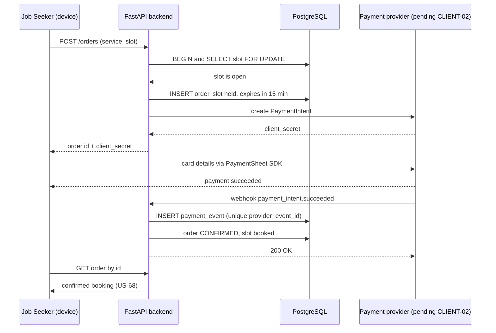
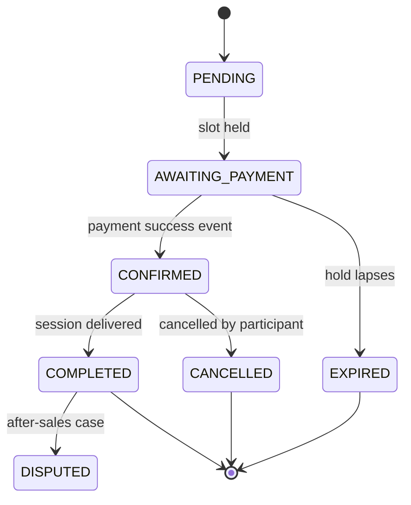

# Design by Concept: Yoir

Team CSD-Koala · SWEN90014 Semester 2, 2026 · Sprint 1

This document explains the architecture drawn in
[`design-by-concept.drawio`](design-by-concept.drawio)
(rendered as [`design-by-concept.png`](design-by-concept.png)):
what each layer is, why each technology was chosen, and how the structure
satisfies the baselined requirements.

The diagram shows the structure. This document carries the reasoning, so the
two should be read together and changed together.

---

## 1. What the requirements already fix

These were settled before any technology choice, and they constrain everything
below.

| Source | Constraint |
|---|---|
| `CLIENT-04`, 25 Aug 2026 | The client is an **installable mobile app**, one Expo / React Native codebase (confirmed). **Which OS(es) are in scope to build, distribute and test for (iOS, Android or both) is not yet confirmed** (client follow-up Q5; team recommendation is open action 3). The single codebase serves either; the scope decision sets build targets, distribution channels, the Apple Developer Program requirement and the device test matrix, not the product code. |
| `CLIENT-03`, confirmed 25 Aug 2026 | English-only interface. No language selector, no saved language preference. |
| `CLIENT-02` | **Not confirmed**: whether this phase must process real payments. The architecture holds both paths open; they differ in one adapter (§2, §4). |
| Baseline §7.2 | A separate browser-based web client is **out of scope** unless approved through change control. |
| Baseline §7.2 | App Store / Play publication is out of scope. Test builds are distributed through TestFlight and Play internal testing. |
| Baseline §6.2 | Access control is enforced **server-side only**. The client may hide an action; it may not be the thing that prevents it. |
| Project Background §6.3 | The client imposed no stack. The team picks technologies it knows and that are well supported, with **team familiarity as the deciding factor**. |

Two further facts shaped the choice: the handover repository contains an
untouched Expo (React Native) scaffold with no product code, and the team has
two frontend developers, two backend developers and one QA lead for roughly
seven weeks of feature delivery across Sprints 2 and 3, implementing the 51
baselined stories (179 SP).

---

## 2. Technology stack

This table is the runtime view of the outcome; the alternatives considered are
recorded in §7.

| Layer | Choice |
|---|---|
| Mobile client | React Native + Expo (SDK 54+), TypeScript, `expo-router` |
| Build and distribution | EAS Build + EAS Submit → TestFlight / Play internal testing, for the OS(es) confirmed under `CLIENT-04` |
| Backend | FastAPI (Python 3.12), Pydantic v2, SQLAlchemy 2.0, Alembic |
| Web server | Uvicorn (ASGI) behind Gunicorn workers |
| Database | PostgreSQL 16 |
| Authentication | JWT access tokens + refresh tokens, Argon2 password hashing |
| Payments | **Undecided, pending `CLIENT-02`.** Default: a payment mock inside the backend. If a real provider is required: Stripe test mode, with the PaymentSheet SDK on device and webhooks to the backend |
| API contract | REST/JSON under `/api/v1`, OpenAPI generated automatically, typed TypeScript client |
| Hosting | Backend container on Render / Fly.io, managed PostgreSQL |
| CI | GitHub Actions: `ruff` + `pytest` for backend, `tsc` + `eslint` + `jest` for the app |

### What the client choice means at runtime

One codebase, not two: with two frontend developers and seven weeks, writing
every one of the 51 stories twice is not deliverable, and one Expo codebase
serves whichever OS scope `CLIENT-04` settles on. The runtime consequences that
matter to this document:

- **EAS Build** produces signed builds in the cloud, so not every developer
  needs a Mac if iOS is in scope.
- **`expo-updates`** pushes JavaScript-only fixes without a full rebuild, which
  matters during demo and handover week.
- A native-module dependency (a real payment SDK, if `CLIENT-02` requires one)
  means Expo Go cannot run the app; it needs a development build. On the mock
  path this constraint does not arise.

### What the backend choice means at runtime

The load-bearing property is the **generated OpenAPI schema**. Running
`openapi-typescript` in CI gives the app a typed client and a mock server, so
the frontend pair is not blocked waiting for endpoints the backend pair has not
written yet, and contract drift becomes a compile error rather than a runtime
surprise. At two developers per side, that decoupling is worth more than raw
framework performance.

Pydantic v2 validates requests and responses at the edge; Alembic gives
versioned, reviewable schema migrations.

---

## 3. Runtime structure

The same left-to-right layers as the concept diagram (actors, client, server,
database), with the external services as a band beneath them.

### Actors

Four roles, matching baseline §4.1 plus the unauthenticated visitor:
**Visitor**, **Job Seeker**, **Career Counsellor**, **Platform Owner**.

The Visitor is first-class because baseline §6.1 makes public browsing a
requirement, not an afterthought: Marketplace listings, service detail and
Forum boards are all readable without an account.

### Front end: on the device

A single Expo application, screens grouped by the role that reaches them.
`expo-router` provides file-based routing and the role gate. Every screen
carries its story ID, which gives QA a direct traceability hook for `NFR-07`.

The **Platform Owner screens live inside the same app**, role-gated, rather
than in a separate web console. Baseline §7.2 excludes a browser-based web
client without change control, and the verification queue, order list and
dispute resolution are list-and-approve interactions that work acceptably on a
phone.

### Backend: in the cloud

Uvicorn serves the FastAPI application behind Gunicorn workers. Inside:

- **REST endpoints**: the HTTP surface, one router per capability area.
- **Domain services**: the business logic, kept out of the route handlers so
  it can be unit tested without HTTP.
- **Cross-cutting concerns**: RBAC dependency guards, Pydantic validation,
  Alembic migrations, OpenAPI client generation, structured logging, and
  background tasks.
- **Data models**: SQLAlchemy 2.0 mappings. The field-level design is
  [`database-schema.md`](database-schema.md).

The frontend may hide unavailable actions, but per baseline §6.2 the backend
remains solely responsible for enforcing roles, resource ownership and the
protection of private data. Every guard is server-side.

### Database

PostgreSQL 16 is the single source of truth, including for concurrency
control; see §4.

### External services

| Service | Role at runtime |
|---|---|
| **Payment provider** (pending `CLIENT-02`) | Either a mock inside the backend (default) or an external provider, working choice Stripe test mode: PaymentSheet SDK on the device, webhooks to the backend |
| **Object storage** | Profile and service images; backend only |
| **Transactional email** | Password reset links (`US-70`); backend only |
| **LinkedIn** (pending `CLIENT-01`) | Working assumption: a submitted URL, opened manually by the Platform Owner, with no runtime API dependency |
| **External meeting link** | Zoom or Meet for online delivery (`US-43`); video is not built in |
| **EAS Build + test tracks** | Build-time only, not a runtime dependency |

On the real-provider path the payment service is the one external system
reached from **both** the device and the backend: two different arrows, for
the reason set out in §4. On the mock path both arrows terminate inside the
backend.

---

## 4. The two flows that drive the design

Most of the architecture is conventional. Two mechanisms are not, and both
exist to satisfy a specific requirement.

### Booking and payment

Three requirements collide here: no raw card data (`NFR-04`), no false success
(`NFR-06`), and no double-booking (`US-41`).

The sequence below is the **real-provider path** (`CLIENT-02` confirmed as
requiring one). On the default mock path, the two device↔provider steps
disappear and the backend raises the same event internally: **the endpoints,
the order states and the confirmation rule are identical either way; only the
provider adapter changes.**



Three things in that flow are load-bearing:

1. **Card details never reach Yoir.** On the real-provider path they go from
   the device straight to the provider through the PaymentSheet SDK; the
   backend only ever handles a PaymentIntent reference. On the mock path there
   is no card data anywhere. Either way, storing raw card data is structurally
   impossible rather than merely prohibited, and it is the cleanest evidence
   the team can offer for `NFR-04`.

2. **The booking is confirmed by the server-side event, never by the client
   callback.** The device's "payment succeeded" message is not trusted, because
   a client can be killed, spoofed or simply lose its network before reporting.
   Only the provider's server-to-server webhook (or, on the mock path, the
   backend's own internally raised event) advances the order.

3. **Event handling is idempotent.** Providers retry deliveries. A unique
   constraint on the provider's event id means a replayed event is a no-op
   instead of a double-charge or a double-confirmation.

Together these mitigate `R-05`: a paid customer with no slot, or the reverse.

### Double-booking prevention

`US-41` and `NFR-06` require that concurrent requests never confirm the same
slot. A mutable status column does not achieve this: two transactions can both
read `status = 'open'` before either writes.

The guarantee is a partial unique index on the order's slot reference, combined
with a row lock taken before the availability check, both inside one
transaction. The loser of a race fails on the index rather than on a stale
read. PostgreSQL is the concurrency primitive; no distributed lock and no Redis
is involved. The mechanism is specified in
[`database-schema.md`](database-schema.md).

### Order state machine



These states are the same on the mock and real-provider paths. A failed or
unknown payment never produces a confirmed booking, which is the constraint
stated in baseline §8.

---

## 5. How the architecture meets the non-functional requirements

| ID | Requirement | How the architecture addresses it |
|---|---|---|
| `NFR-01` | Critical journeys clear without guidance | One codebase means one set of copy and one set of state transitions; no per-platform drift |
| `NFR-02` | Every in-scope platform supports every journey | Single Expo codebase; EAS builds the same source for each target, so a feature cannot exist on one platform only. The breadth of the test matrix follows the `CLIENT-04` OS-scope decision |
| `NFR-03` | Touch and accessibility services | React Native maps to native accessibility APIs on both platforms; verified by automated checks plus manual screen-reader review |
| `NFR-04` | Passwords, tokens, payments, roles protected | Argon2 hashing, refresh tokens revocable at logout, RBAC guards server-side, card data never reaches Yoir on either payment path |
| `NFR-05` | Public endpoints expose only public data | Public routers are separate from authenticated ones; ownership checks live in the domain services, not the UI |
| `NFR-06` | State consistency, no double-booking or false success | Unique index plus row lock for slots; confirmation only on the server-side payment event; idempotent event handling |
| `NFR-07` | Stable IDs traced to verification evidence | Every screen and endpoint carries its US id; operations carry `x-requirement-ids` in `openapi.yaml` and in the interface traceability CSV |
| `NFR-08` | All system copy in English | Single English string set; no i18n layer, per `CLIENT-03` |

---

## 6. Risk mitigations carried into the design

| Risk | Architectural response |
|---|---|
| `R-01` LinkedIn API does not expose what verification needs | No API dependency at all on the working assumption. A submitted URL plus manual Platform Owner review. API integration stays a spike, pending `CLIENT-01` |
| `R-03` A live payment account needs a registered business | The default mock path needs no account at all. If a real provider is confirmed, **test mode** behind a payment boundary, so live keys become a configuration swap, not a rewrite |
| `R-04` App store in-app-purchase rules | Sessions are real-world services delivered outside the app, via external meeting link or in person. A provider's mobile SDK is used, not IAP. Moot for this semester, since store publication is out of scope |
| `R-05` Payment succeeds but booking does not | Confirmation only on the server-side event, idempotent event handling, expiring slot holds |

---

## 7. What was deliberately left out

Recorded as decisions rather than omissions, so a reviewer can see they were
considered.

| Excluded | Reason |
|---|---|
| **Redis** | Its two justifications do not hold here. Double-booking is solved correctly by PostgreSQL constraints, and background jobs are served by FastAPI `BackgroundTasks`. Celery plus Redis is operational work the timeline cannot absorb. Revisit if load testing shows a need |
| **WebSockets for messaging** | Order-linked chat polls with a `?since=` cursor. Adequate for text-only messaging between two participants, and it removes a connection-management dependency from Sprint 2. A Sprint 3 upgrade if time allows |
| **Two native codebases** | Not deliverable with two frontend developers in seven weeks, and not required, since one codebase serves whichever OS scope `CLIENT-04` settles |
| **A separate web admin console** | Excluded by baseline §7.2 without change control. Platform Owner functions are role-gated screens in the same app |
| **Built-in video calling** | Out of scope per baseline §7.2. Online delivery uses an external meeting link |
| **Push notifications** | Optional, Sprint 3 at the earliest. Not required by any baselined story |
| **Multilingual UI** | Excluded by `CLIENT-03` |

---

## 8. Walking skeleton

This is what makes the architecture *executable* rather than proposed. The
Sprint 1 milestone tag is `v0.1.0-executable-architecture`. The skeleton is one
thin vertical slice through every layer, running on the in-scope simulator(s)
against the deployed backend:

```text
register → login → browse marketplace → open service detail
```

That slice exercises authentication, role-based access, the database, the API
contract, the generated TypeScript client, the platform build and CI, all
before anyone touches booking or payments. If any layer is wrong, it is wrong cheaply
and early.

It deliberately stops short of the payment flow, which is the one part of §4
that cannot be finished until `CLIENT-02` is answered.

---

## 9. Open items

The items still unconfirmed by the client, with the runtime consequence of each.

| # | Item | Working assumption | Owner |
|---|---|---|---|
| 1 | `CLIENT-04` target OS scope: iOS, Android or both | **Not confirmed.** One Expo codebase serves either. Sets build targets, distribution channels, the Apple Developer Program need and the device test matrix | Product Owner / frontend pair |
| 2 | `CLIENT-02`: is real payment processing in scope this phase? | **Not confirmed.** Default: backend payment mock. Fallback if a real provider is required: Stripe test mode. Provider and the test-vs-live boundary both unconfirmed. A confirmed answer must be dated and propagated | Product Owner |
| 3 | `CLIENT-01` counsellor verification approach | **Not confirmed, to be considered by the client.** Working assumption: manual LinkedIn URL review | Product Owner |
| 4 | Hosting and object-storage provider | Render / Fly.io + managed PostgreSQL + S3-compatible storage, unconfirmed | Backend pair |
| 5 | **Apple Developer Program enrolment** (US$99/yr) | Needed only if iOS is in scope (item 1); a hard prerequisite for any iOS build on a physical device, and a native-module dependency means Expo Go cannot substitute. Android can ship as a plain APK; Play internal testing needs a one-time US$25 account. Multi-day external lead time, and the only item here the team cannot compress | To be assigned |
| 6 | OS-version and device/screen test matrix | Required by `NFR-02` before acceptance testing; its breadth follows item 1 | QA Lead |
| 7 | Counsellor spoken languages | Confirmed by the client on 25 Aug as profile and search data, but not yet in the 51-story baseline | Product Owner |

---

## 10. References

| Document | Location |
|---|---|
| Architecture diagram (source · export) | [`design-by-concept.drawio`](design-by-concept.drawio) · [`design-by-concept.png`](design-by-concept.png) |
| Database design | [`database-schema.md`](database-schema.md) |
| Interface contract | [`executable-architecture/interface-contract.md`](../executable-architecture/interface-contract.md) |
| Published API | [`executable-architecture/openapi.yaml`](../executable-architecture/openapi.yaml) |
| Interface traceability | [`executable-architecture/interface-traceability.csv`](../executable-architecture/interface-traceability.csv) |
| Client decisions | [Client meeting minutes, 25 Aug 2026](../meeting-minutes/Client%20Meeting/2026-08-25-joint-client-meeting.md) |
| Product backlog | [Requirements wiki](https://github.com/swen90014-2026-sm2/SWEN90014-2026-CSD-Koala/wiki/Requirements) |
| Background and scope | [Project Background and Scope](https://github.com/swen90014-2026-sm2/SWEN90014-2026-CSD-Koala/wiki/Project-Background-and-Scope) |
| Risk register | [Risk Register](https://github.com/swen90014-2026-sm2/SWEN90014-2026-CSD-Koala/wiki/Risk-Register) |
