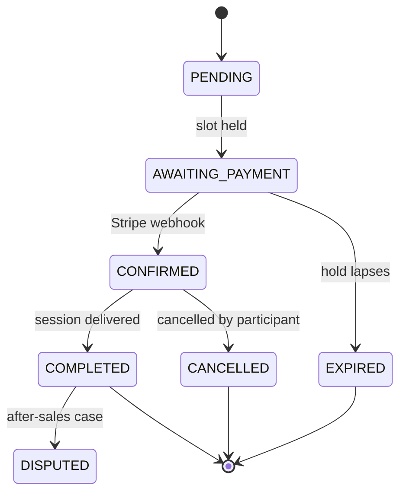

# Executable Architecture — Yoir

Team CSD-Koala · SWEN90014 Semester 2, 2026 · Sprint 1

This document explains the architecture drawn in
[`executable-architecture.drawio`](executable-architecture.drawio)
(rendered as [`executable-architecture.png`](executable-architecture.png)):
what each layer is, why each technology was chosen, and how the structure
satisfies the baselined requirements.

The diagram shows the structure. This document carries the reasoning, so the
two should be read together and changed together.

---

## 1. What the requirements already fix

Four decisions were settled before any technology choice, and they constrain
everything below.

| Source | Constraint |
|---|---|
| `CLIENT-04`, confirmed 2026-08-25 | Deliver an installable app for **both Android and iOS**. The requirements explicitly do **not** mandate separate native codebases. |
| `CLIENT-03`, confirmed 2026-08-25 | English-only interface. No language selector, no saved language preference. |
| Baseline §7.2 | A separate browser-based web client is **out of scope** unless approved through change control. |
| Baseline §7.2 | App Store / Play publication is out of scope. Test builds are distributed through TestFlight and Play internal testing. |
| Project Background §6.3 | The client imposed no stack. The team picks technologies it knows and that are well supported, with **team familiarity as the deciding factor**. |

Two further facts shaped the choice: the handover repository contains an
untouched Expo (React Native) scaffold with no product code, and the team has
two frontend developers, two backend developers and one QA lead for roughly
seven weeks of feature delivery across Sprints 2 and 3.

---

## 2. Technology stack

| Layer | Choice |
|---|---|
| Mobile client | React Native + Expo (SDK 54+), TypeScript, `expo-router` |
| Build and distribution | EAS Build + EAS Submit → TestFlight / Play internal testing |
| Backend | FastAPI (Python 3.12), SQLAlchemy 2.0, Alembic |
| Web server | Uvicorn (ASGI) behind Gunicorn workers |
| Database | PostgreSQL 16 |
| Authentication | JWT access tokens + refresh tokens, Argon2 password hashing |
| Payments | Stripe test mode — PaymentSheet SDK on device, webhooks to the backend |
| API contract | REST/JSON, OpenAPI generated automatically, typed TypeScript client |
| Hosting | Backend container on Render / Fly.io, managed PostgreSQL |
| CI | GitHub Actions — `ruff` + `pytest` for backend, `tsc` + `eslint` + `jest` for the app |

### Why cross-platform, and why Expo

Two native codebases were rejected on arithmetic rather than preference. With
two frontend developers and seven weeks, writing every one of the 51 stories
twice is not deliverable, and `CLIENT-04` explicitly permits a single
codebase.

Between Expo and Flutter, the deciding factor named in the requirements is
team familiarity. The handover scaffold is already Expo, and TypeScript on the
client means the frontend and backend pairs can review across the boundary.
Flutter is a capable alternative and would have been chosen if both frontend
developers already wrote Dart.

The practical wins for this project specifically:

- **EAS Build** produces signed iOS builds in the cloud, so not every
  developer needs a Mac.
- **`expo-updates`** pushes JavaScript fixes without a full rebuild, which
  matters during demo and handover week.
- **EAS Submit** delivers to TestFlight and Play internal testing, which is
  exactly the distribution target the baseline defines.

### Why FastAPI

FastAPI was already recorded as the backend architecture on the requirements
wiki, so keeping it costs nothing in re-documentation.

The substantive argument is the **generated OpenAPI schema**. Running
`openapi-typescript` in CI gives the app a typed client and a mock server, so
Ariz and James are not blocked waiting for endpoints that Evelyn and Jashan
have not written yet. At a team size of two developers per side, that
decoupling is worth more than raw framework performance.

Pydantic v2 gives request and response validation at the edge, and Alembic
gives versioned, reviewable schema migrations.

If the backend pair were materially stronger in TypeScript than Python,
NestJS would be the alternative worth taking, for the same
one-language-across-the-stack reason.

---

## 3. Runtime structure

The diagram is arranged in the same left-to-right layers as the reference
architecture from the lecture: actors, client, server, database — with two
additions the reference did not need.

### Actors

Four roles, matching baseline §4.1 plus the unauthenticated visitor:
**Visitor**, **Job Seeker**, **Career Counsellor**, **Platform Owner**.

The Visitor is drawn as a first-class actor because baseline §6.1 makes public
browsing a requirement, not an afterthought: Marketplace listings, service
detail, and Forum boards are all readable without an account.

### Front end — on the device

A single Expo application, with screens grouped by the role that reaches them.
`expo-router` provides file-based routing and the role gate. Every screen box
in the diagram carries its story ID, which gives QA a direct traceability hook
for `NFR-07`.

The **Platform Owner screens live inside the same app**, role-gated, rather
than in a separate web console. Baseline §7.2 excludes a browser-based web
client without change control, so a web admin panel would require a change
request. The verification queue, order list and dispute resolution are all
list-and-approve interactions that work acceptably on a phone.

### Backend — in the cloud

Uvicorn serves the FastAPI application behind Gunicorn workers. Inside:

- **REST endpoints** — the HTTP surface, one router per capability area.
- **Domain services** — the business logic, kept out of the route handlers so
  it can be unit tested without HTTP.
- **Cross-cutting concerns** — RBAC dependency guards, Pydantic validation,
  Alembic migrations, OpenAPI client generation, structured logging, and
  background tasks.
- **Data models** — SQLAlchemy 2.0 mappings. The full field-level design is a
  separate document, [`database-schema.md`](database-schema.md).

The frontend may hide unavailable actions, but per baseline §6.2 the backend
remains solely responsible for enforcing roles, resource ownership and the
protection of private data. Every guard in the diagram is server-side.

### Database

PostgreSQL 16 is the single source of truth, including for concurrency
control — see §4.

### External services

The lecture reference had no external dependencies. Yoir has five that are
architecturally significant, drawn as a band beneath the main layers:

| Service | Role |
|---|---|
| **Stripe (test mode)** | PaymentSheet SDK on the device; webhooks to the backend |
| **Object storage** | Profile and service images |
| **Transactional email** | Password reset links (`US-70`) |
| **LinkedIn** | A submitted URL, opened manually by the Platform Owner — no API dependency |
| **External meeting link** | Zoom or Meet for online delivery (`US-43`); video is not built in |

Stripe is deliberately positioned at the frontend/backend boundary in the
diagram, because two different arrows reach it. That is the subject of §4.

---

## 4. The two flows that drive the design

Most of the architecture is conventional. Two mechanisms are not, and both
exist to satisfy a specific requirement.

### Booking and payment

Three requirements collide here: no raw card data (`NFR-04`), no false
success (`NFR-06`), and no double-booking (`US-41`).

```mermaid
sequenceDiagram
    participant JS as Job Seeker (device)
    participant API as FastAPI backend
    participant DB as PostgreSQL
    participant S as Stripe (test mode)

    JS->>API: POST /orders (service, slot)
    API->>DB: BEGIN and SELECT slot FOR UPDATE
    DB-->>API: slot is open
    API->>DB: INSERT order; slot held, expires in 15 min
    API->>S: create PaymentIntent
    S-->>API: client_secret
    API-->>JS: order id + client_secret
    JS->>S: card details via PaymentSheet SDK
    S-->>JS: payment succeeded
    S->>API: webhook payment_intent.succeeded
    API->>DB: INSERT payment_event (unique provider_event_id)
    API->>DB: order CONFIRMED; slot booked
    API-->>S: 200 OK
    JS->>API: GET /orders/:id
    API-->>JS: confirmed booking (US-68)
```

Three things in that diagram are load-bearing:

1. **Card details never reach Yoir.** They go from the device straight to
   Stripe through the PaymentSheet SDK. The backend only ever handles a
   PaymentIntent reference. This makes storing raw card data structurally
   impossible rather than merely prohibited, which is the cleanest evidence
   the team can offer for `NFR-04`.

2. **The booking is confirmed by the webhook, never by the client callback.**
   The device's "payment succeeded" message is not trusted, because a client
   can be killed, spoofed or simply lose its network before reporting. Only
   Stripe's server-to-server webhook advances the order.

3. **The webhook is idempotent.** Stripe retries deliveries. A unique
   constraint on the provider's event id means a replayed event is a no-op
   instead of a double-charge or a double-confirmation.

Together these mitigate `R-05` — a paid customer with no slot, or the reverse.

### Double-booking prevention

`US-41` and `NFR-06` require that concurrent requests never confirm the same
slot. A mutable status column does not achieve this: two transactions can both
read `status = 'open'` before either writes.

The guarantee is a partial unique index on the order's slot reference,
combined with a row lock taken before the availability check, both inside one
transaction. The loser of a race fails on the index rather than on a stale
read. PostgreSQL is the concurrency primitive; no distributed lock is
involved. The mechanism is specified in
[`database-schema.md`](database-schema.md).

### Order state machine



A failed or unknown payment never produces a confirmed booking, which is the
constraint stated in baseline §8.

---

## 5. How the architecture meets the non-functional requirements

| ID | Requirement | How the architecture addresses it |
|---|---|---|
| `NFR-01` | Critical journeys clear without guidance | One codebase means one set of copy and one set of state transitions; no per-platform drift |
| `NFR-02` | Both platforms support every journey | Single Expo codebase; EAS builds the same source for both, so a feature cannot exist on one platform only |
| `NFR-03` | Touch and accessibility services | React Native maps to native accessibility APIs on both platforms; verified by automated checks plus manual screen-reader review |
| `NFR-04` | Passwords, tokens, payments, roles protected | Argon2 hashing, refresh tokens revocable at logout, RBAC guards server-side, card data never reaches Yoir |
| `NFR-05` | Public endpoints expose only public data | Public routers are separate from authenticated ones; ownership checks live in the domain services, not the UI |
| `NFR-06` | State consistency, no double-booking or false success | Unique index plus row lock for slots; webhook-only confirmation; idempotent event handling |
| `NFR-07` | Stable IDs traced to verification evidence | Every screen and endpoint in the diagram carries its US id |
| `NFR-08` | All system copy in English | Single English string set; no i18n layer, per `CLIENT-03` |

---

## 6. Risk mitigations carried into the design

| Risk | Architectural response |
|---|---|
| `R-01` LinkedIn API does not expose what verification needs | No API dependency at all. A submitted URL plus manual Platform Owner review. API integration stays a spike |
| `R-03` A live payment account needs a registered business | Stripe **test mode** behind a payment boundary. Live keys become a configuration swap, not a rewrite |
| `R-04` App store in-app-purchase rules | Sessions are real-world services delivered outside the app, via external meeting link or in person. The provider's mobile SDK is used, not IAP. Moot for this semester, since store publication is out of scope |
| `R-05` Payment succeeds but booking does not | Webhook-only confirmation, idempotent event handling, expiring slot holds |

---

## 7. What was deliberately left out

Recording these as decisions rather than omissions, so a reviewer can see they
were considered.

| Excluded | Reason |
|---|---|
| **Redis** | Its two justifications do not hold here. Double-booking is solved correctly by PostgreSQL constraints, and background jobs are served by FastAPI `BackgroundTasks`. Celery plus Redis is operational work the timeline cannot absorb. Revisit if load testing shows a need |
| **WebSockets for messaging** | Order-linked chat polls with a `?since=` cursor. Adequate for text-only messaging between two participants, and it removes a connection-management dependency from Sprint 2. A Sprint 3 upgrade if time allows |
| **Two native codebases** | Not deliverable with two frontend developers in seven weeks, and not required by `CLIENT-04` |
| **A separate web admin console** | Excluded by baseline §7.2 without change control. Platform Owner functions are role-gated screens in the same app |
| **Built-in video calling** | Out of scope per baseline §7.2. Online delivery uses an external meeting link |
| **Push notifications** | Optional, Sprint 3 at the earliest. Not required by any baselined story |

---

## 8. Walking skeleton

The Sprint 1 milestone tag is `v0.1.0-executable-architecture`. The skeleton
is one thin vertical slice through every layer, running on both simulators
against the deployed backend:

```text
register → login → browse marketplace → open service detail
```

That slice exercises authentication, role-based access, the database, the API
contract, the generated TypeScript client, both platform builds and CI —
before anyone touches booking or payments. If any layer is wrong, it is wrong
cheaply and early.

---

## 9. Open items

| # | Item | Owner | Notes |
|---|---|---|---|
| 1 | **Apple Developer Program enrolment** (US$99/yr) | To be assigned | Multi-day external approval, and a hard prerequisite for any iOS build on a physical device — the Stripe SDK is a native module, so Expo Go cannot run the app. Android can ship as a plain APK for free; Play internal testing needs a one-time US$25 account. This is the only item here with a lead time the team cannot compress |
| 2 | Hosting provider confirmation | Backend pair | Render / Fly.io and the object storage provider are placeholders in the diagram until provisioned |
| 3 | `CLIENT-02` payment boundary | Product Owner | Test mode is the working assumption. A confirmed client answer must be dated and propagated |
| 4 | `CLIENT-01` verification approach | Product Owner | Manual URL review is the working assumption |
| 5 | OS-version and device/screen test matrix | QA Lead | Required by `NFR-02` before acceptance testing |
| 6 | Counsellor spoken languages | Product Owner | Confirmed by the client on 25 Aug as profile and search data, but not yet in the 51-story baseline |

---

## 10. References

| Document | Location |
|---|---|
| Architecture diagram | [`executable-architecture.drawio`](executable-architecture.drawio) · [`.png`](executable-architecture.png) |
| Database schema | [`database-schema.md`](database-schema.md) |
| Product backlog | [Requirements wiki](https://github.com/swen90014-2026-sm2/SWEN90014-2026-CSD-Koala/wiki/Requirements) |
| Background and scope | [Project Background and Scope](https://github.com/swen90014-2026-sm2/SWEN90014-2026-CSD-Koala/wiki/Project-Background-and-Scope) |
| Risk register | [Risk Register](https://github.com/swen90014-2026-sm2/SWEN90014-2026-CSD-Koala/wiki/Risk-Register) |
| Client decisions | [Client meeting minutes](https://github.com/swen90014-2026-sm2/SWEN90014-2026-CSD-Koala/wiki/Client-meeting-minutes), 25 Aug 2026 |
