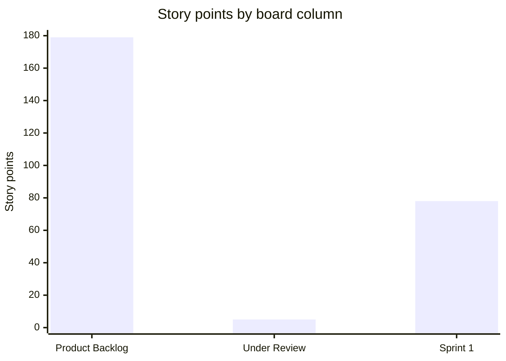
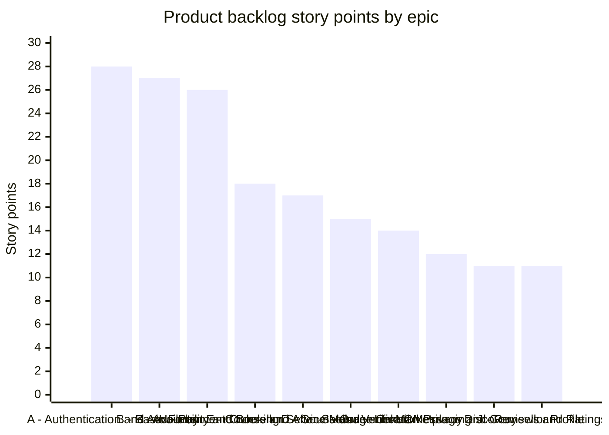
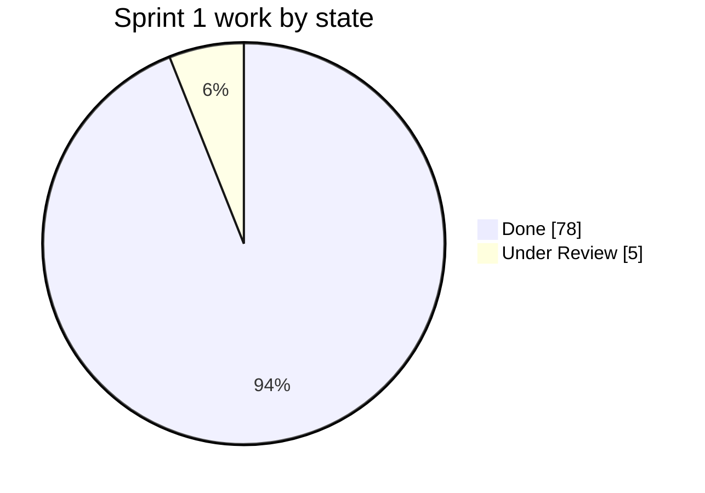
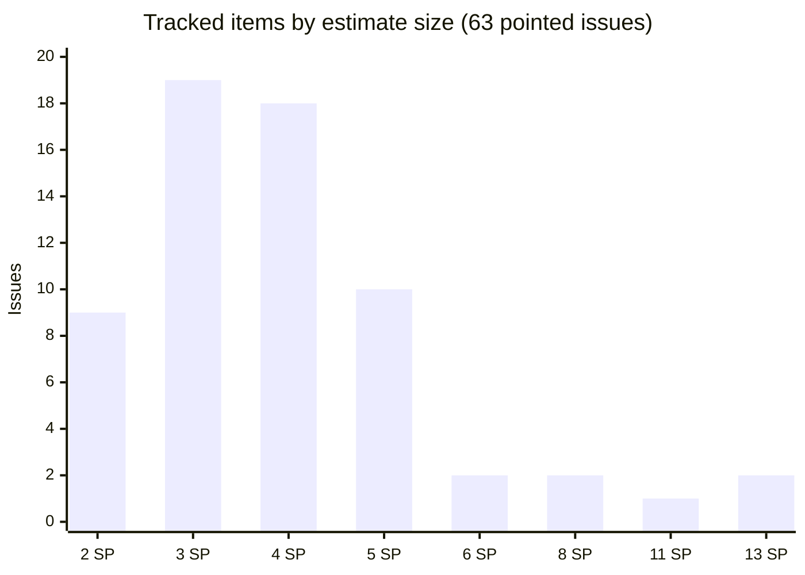
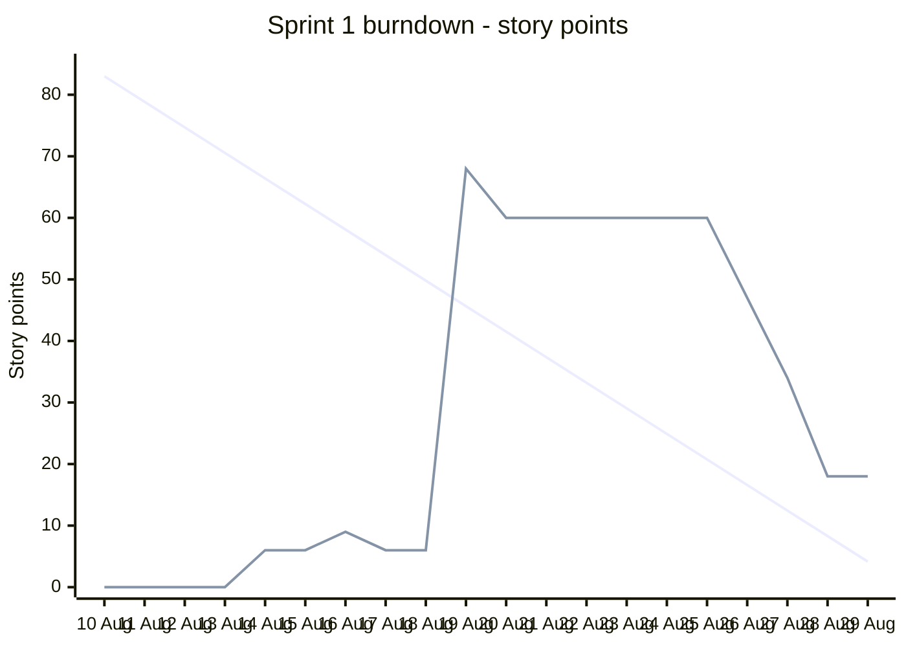

# Process Documentation and Insights

How Team Koala runs the project. Roles are on [Team Details](https://github.com/swen90014-2026-sm2/SWEN90014-2026-CSD-Koala/wiki/Team-Details); meeting records are in [Client meeting minutes](https://github.com/swen90014-2026-sm2/SWEN90014-2026-CSD-Koala/wiki/Client-meeting-minutes) and [Daily Standups](https://github.com/swen90014-2026-sm2/SWEN90014-2026-CSD-Koala/wiki/Daily-Standups).

## 1. Ceremonies

| Ceremony | When | Notes |
|---|---|---|
| Stand-up | Weekly | What you worked on, what you plan for the coming week. |
| Tutorial | Friday 3:00–4:00 pm | With tutor Erfan Farabi. |
| Supervisor meeting | Scheduled via When2Meet, Zoom | Erfan observes, Scrum Master runs it. Minuted. |
| Internal meeting | Straight after the supervisor session or tutorial | Follow up actions without the supervisor present. Minuted. |
| Sprint planning / review / retrospective | Start and end of each sprint | Recorded in Meeting Minutes on the day. |

## 2. Tracker

All work lives on the [project board](https://github.com/orgs/swen90014-2026-sm2/projects/6) as issues in the repo.

- **Stories** (`[US-nn]`): the 51 baselined product backlog items, with Epic, Priority (Must-have / Should-have) and Story Points. 179 SP total.
- **Sprint tasks** (`[S1-nn]`): the sprint backlog, with Rubric criterion, Sprint iteration and owners.

**Status flow:** Product Backlog → Sprint Backlog → In Progress → Under Review → Sprint N (done column for that sprint). **Blocked** is used when a task is waiting on something outside the owner's control; name the blocker in a comment.

At sprint end, unfinished items roll their Sprint field forward to the next iteration.

## 3. Estimation

Story points assigned at planning. Sizing guide (from supervisor guidance): ~1 SP ≈ half a day, 2–3 SP ≈ a day or two, 5 SP ≈ two–three days, 8 SP ≈ up to a week. Anything larger is an epic and must be broken down before it enters a sprint.

## 4. Branching and code workflow

Three levels: `main` → `dev` → feature branches.

| Branch | Purpose | Rule |
|---|---|---|
| `main` | Stable, always runnable. Milestone tags live here (e.g. `v0.1.0-executable-architecture`). | Never push directly. Only `dev` merges in, via PR, at the end of a sprint or milestone. |
| `dev` | Integration, where the current sprint's work comes together. | Never push directly. Only feature branches merge in, via reviewed PR. |
| `feat/<id>-<name>` | One branch per board item, cut from `dev`. E.g. `feat/S1-04-slot-reservation`. Use `fix/`, `docs/`, `chore/` prefixes for non-feature work. | Deleted after merge. |

### Day-to-day flow

1. Start from a fresh `dev`:
   `git checkout dev && git pull`
2. Branch for your task:
   `git checkout -b feat/S1-04-slot-reservation`
3. Commit as you go, then push the branch:
   `git push -u origin feat/S1-04-slot-reservation`
4. Open a PR **into `dev`** and put `Closes #58` in the description so the board item closes on merge.
5. Review: the other member of your sub-team (frontend: Ariz / James, backend: Evelyn / Jashan) approves; QA (Zhenyang) checks acceptance criteria.
6. Merge, delete the branch, pull `dev` before starting the next task.

## 5. Definition of Ready and Definition of Done

Both are owned by the Product Owner and maintained on the [Product Backlog](https://github.com/swen90014-2026-sm2/SWEN90014-2026-CSD-Koala/wiki/Product-Backlog) page, which is the source of truth for them. They are reproduced here because they gate every item on the board.

**Ready.** A story is ready for implementation when:

- its user role, outcome, priority, and acceptance criteria are agreed;
- frontend and backend teams use the same story ID and behaviour;
- dependencies, authorisation rules, error states, and relevant data are understood;
- any required client decision has been recorded;
- the story is small enough to plan or has been split into independently verifiable work;
- its acceptance tests can be derived without inventing missing product behaviour.

**Done.** A story is done only when:

- its acceptance criteria pass at frontend, backend, and end-to-end levels where applicable;
- backend role, ownership, privacy, and state rules are enforced;
- the frontend represents backend success, failure, and pending states accurately;
- relevant automated and manual tests pass;
- the implementation is peer reviewed and merged;
- the story is demonstrated in sprint review;
- the feature is deployed to the agreed test environment;
- user-facing behaviour works on the agreed target OS(es), supported versions, devices or simulators, and screen-size matrix;
- the shared requirements and traceability records are updated if the delivered behaviour differs from the approved story.

## 6. Records

- [Client meeting minutes](https://github.com/swen90014-2026-sm2/SWEN90014-2026-CSD-Koala/wiki/Client-meeting-minutes), every client and supervisor meeting, with decisions, rationale and owned actions.
- [Daily Standups](https://github.com/swen90014-2026-sm2/SWEN90014-2026-CSD-Koala/wiki/Daily-Standups), the weekly stand-up records.
- [Mentor Communication Log](https://github.com/swen90014-2026-sm2/SWEN90014-2026-CSD-Koala/wiki/Mentor-Communication-Log), correspondence with the tutor.
- [Sprint 1 Test Approach](https://github.com/swen90014-2026-sm2/SWEN90014-2026-CSD-Koala/wiki/Sprint-1-Test-Approach), the QA strategy, evidence boundaries, database safety rules and current executable-architecture results.

## 7. Board insights

<!-- board-insights:start -->
<!-- Generated by .github/workflows/board-insights.yml. Do not edit this block by hand. -->

_Snapshot of [Project Board 6](https://github.com/orgs/swen90014-2026-sm2/projects/6); source data last updated **29 Aug 2026, 06:08 UTC**._

**68 Issue item(s), 262 story points currently tracked.**

Detected active iteration: **Sprint 1** (10 Aug 2026 to 30 Aug 2026).

> **Data-quality warnings**
> - 5 Issue item(s) have no Story Points value.
> - 5 sprint-flow item(s) have no Sprint iteration value.

### 7.1 Where the work sits

| Column | Issues | Story points | Share of pointed scope |
|---|---:|---:|---:|
| Product Backlog | 51 | 179 | 68% |
| Under Review | 1 | 5 | 2% |
| Sprint 1 (Done) | 16 | 78 | 30% |

**Observed result.** This distribution is a snapshot of the current Status values. It describes where board items are now; it does not prove delivery, acceptance or carry-over.

### 7.2 What the product backlog is made of

| Epic | Stories | Story points |
|---|---:|---:|
| A - Authentication and Accounts | 9 | 28 |
| B - Basic Forum | 9 | 27 |
| F - Availability and Booking | 7 | 26 |
| H - Payment Orders and After-Sales | 4 | 18 |
| E - Counsellor Service Management | 5 | 17 |
| D - Counsellor Verification | 4 | 15 |
| I - Order-Linked Messaging | 4 | 14 |
| G - Marketplace Discovery | 3 | 12 |
| C - Privacy and Counsellor Profile | 3 | 11 |
| J - Reviews and Ratings | 3 | 11 |

**Observed result.** Epic totals include only items currently in the Product Backlog column. Unassigned values remain visible instead of being inferred.

### 7.3 Current sprint state

| State | Issues | Story points |
|---|---:|---:|
| Done | 16 | 78 |
| Under Review | 1 | 5 |

**Observed result.** 78 of 83 pointed SP are in the **Sprint 1** done column and 5 SP are under review. Board placement is not treated as proof that acceptance criteria passed.

### 7.4 Estimate-size distribution

| Size | Product backlog | Current sprint | All board Issues |
|---|---:|---:|---:|
| 2 SP | 9 | 0 | 9 |
| 3 SP | 16 | 3 | 19 |
| 4 SP | 18 | 0 | 18 |
| 5 SP | 7 | 3 | 10 |
| 6 SP | 1 | 1 | 2 |
| 8 SP | 0 | 2 | 2 |
| 11 SP | 0 | 1 | 1 |
| 13 SP | 0 | 2 | 2 |

**Observed result.** 63 Issue item(s) are pointed and 5 are unpointed. This chart reports the distribution without deciding whether an estimate is appropriately sized.

### 7.5 Current sprint burndown

| Date | Remaining from Issue state (SP) | Ideal from current scope (SP) |
|---|---:|---:|
| 10 Aug 2026 | 0 | 83 |
| 29 Aug 2026 | 18 | 4.15 |
| 30 Aug 2026, sprint end | — | 0 |

**Method limitation.** Remaining work uses each Issue's open/closed state and `closedAt`; GitHub's standard ProjectV2 query does not provide historical Status or Story Points transitions. The ideal line uses today's recorded sprint scope. This is an indicative burndown, not a reconstruction of every past board movement.

### 7.6 Data-quality checks

- Closed Issues outside **Sprint 1** (Done): **1**
- Open Issues inside **Sprint 1** (Done): **3**
- Sprint-flow Issues without a Sprint iteration: **5**

These checks expose differences between Issue state and Project fields; they do not silently reconcile or average the two sources.

<!-- board-insights:end -->
