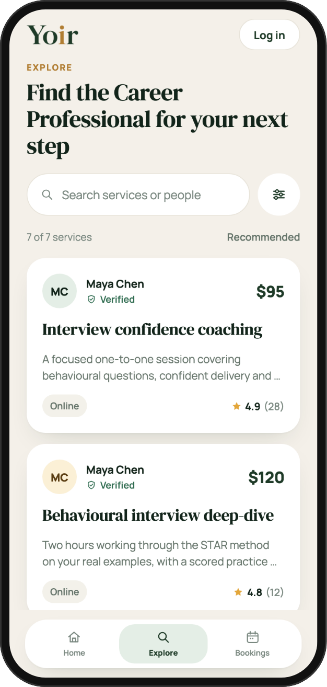
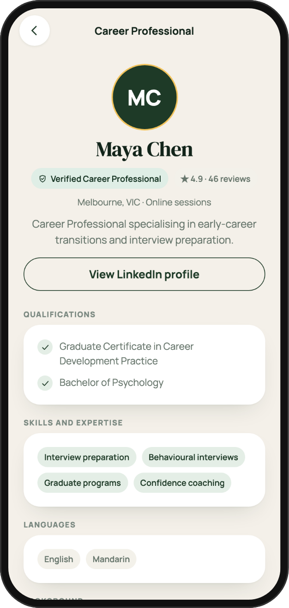
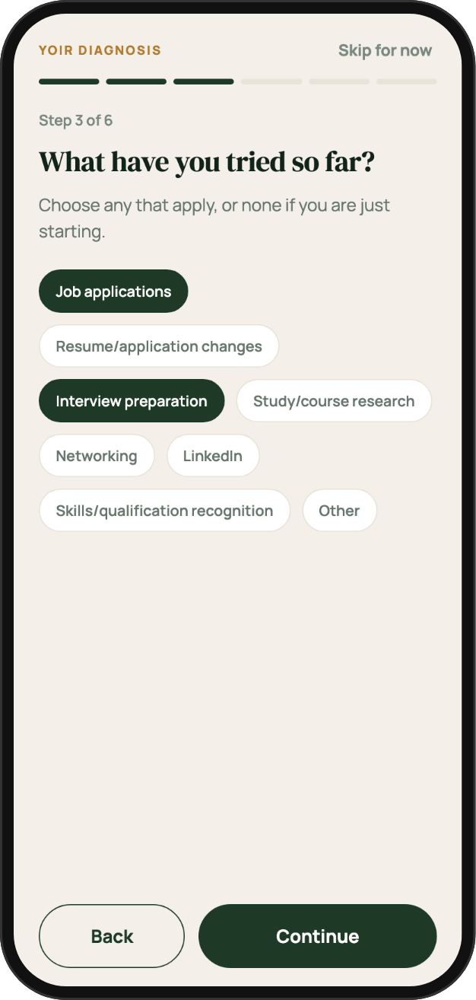
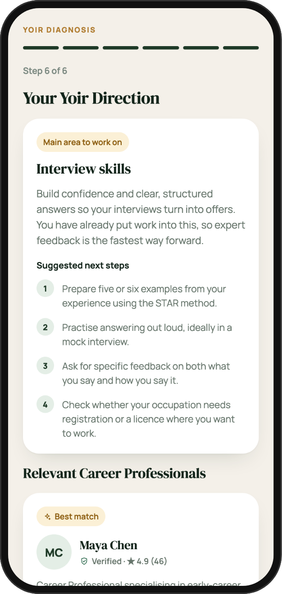
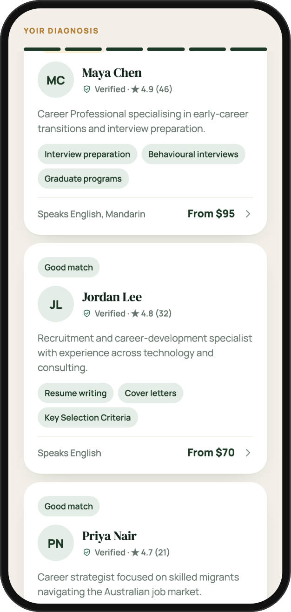
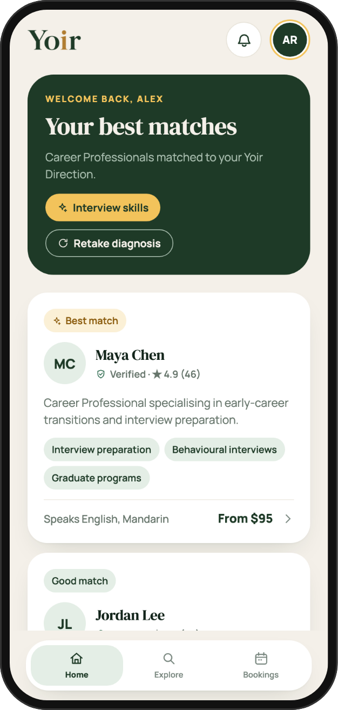

<!--
  Exported from the project wiki. Do not edit here - edit the wiki page and re-export.
  Source page: Sprint 2 Feedback Implemented
  Source URL:  https://github.com/swen90014-2026-sm2/SWEN90014-2026-CSD-Koala/wiki/Sprint-2-Client-Feedback-Response
  Wiki commit: 9bf9bb8 (2026-09-19)
  Exported:    2026-09-19
-->

# Sprint 2 Feedback Implemented

Client feedback of 17 September 2026 (FB01–FB07 in [Sprint 2 Review & Client Feedback](https://github.com/swen90014-2026-sm2/SWEN90014-2026-CSD-Koala/wiki/Sprint-2-Review-and-Client-Feedback)), implemented in Sprint 2. Screenshots are from the development build with demo data.

## 1. Career Professional and Explore

- The app says **Career Professional** instead of Career Counsellor on every screen, message and email.
- The screen for browsing services is called **Explore**; "Marketplace" no longer appears.

| Welcome | Explore |
|---|---|
|  |  |

## 2. Career Professional profiles

- Every service links to the Career Professional's full profile with **View full profile**.
- The profile shows qualifications, skills and expertise, languages, LinkedIn, background, experience, location, rating, the verified badge and all of their services.
- Career Professionals fill in their qualifications, skills and expertise, and languages on their own profile.

| From a service | The profile | More of the profile | What the Career Professional fills in |
|---|---|---|---|
|  |  |  |  |

## 3. The Yoir Diagnosis and direction

- A new Job Seeker starts with the **Yoir Diagnosis**: the client's six steps, in the client's wording, one question per screen.
- Step 6, **Your Yoir Direction**, gives the main area to work on and suggested next steps, and lists the relevant Career Professionals.
- The Job Seeker's home screen shows **their best matches**, with a button to retake the diagnosis.

| Step 1 | Step 3 | Step 6: Your Yoir Direction | Relevant Career Professionals | Home: best matches |
|---|---|---|---|---|
|  |  |  |  |  |

## 4. Branding and typography

- Headings use DM Serif Display, a typeface close to the Yoir wordmark.
- Screens use the logo's cream, green and gold.
- The home screen opens with a green Yoir brand panel.

The screenshots above show the new look throughout.

## 5. Booking connected to the career journey

- The diagnosis leads to a direction, the direction to best-matched Career Professionals, each match to their full profile, and the profile to their services and booking.
