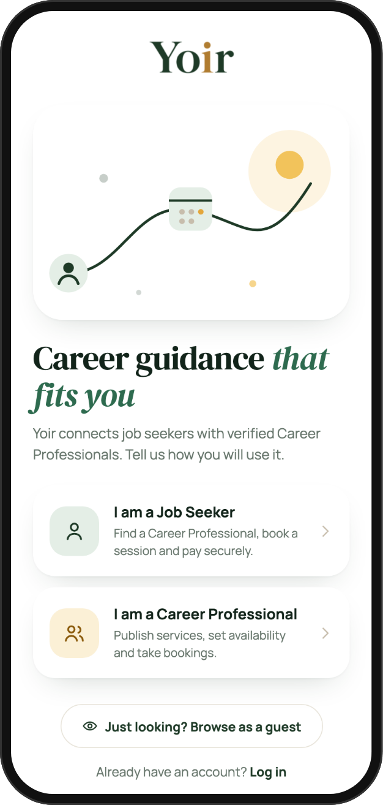
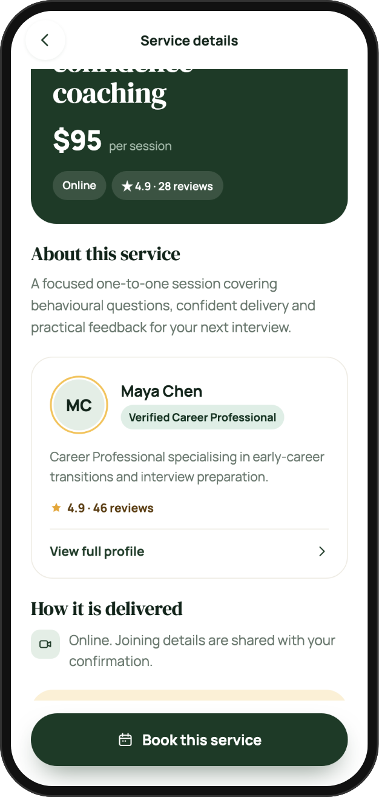
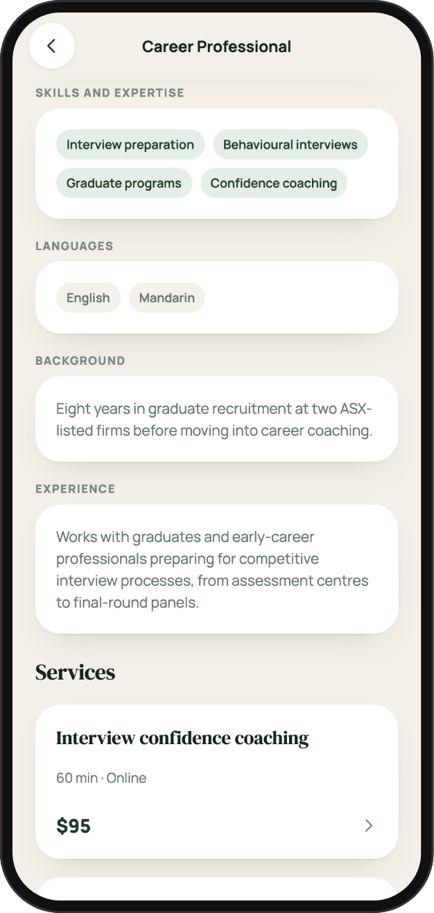
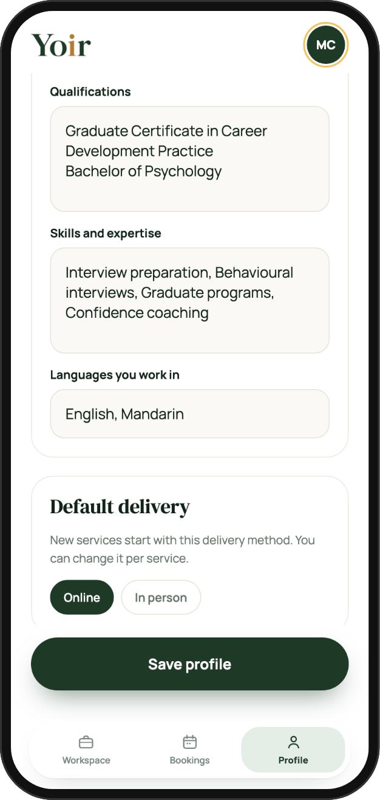
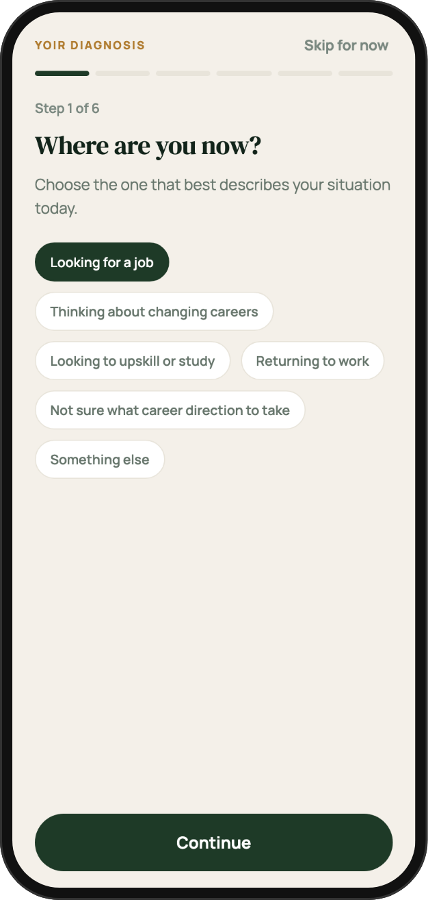

<!--
  Exported from the project wiki. Do not edit here - edit the wiki page and re-export.
  Source page: Response to Sam's Sprint 2 Feedback
  Source URL:  https://github.com/swen90014-2026-sm2/SWEN90014-2026-CSD-Koala/wiki/Sprint-2-Client-Feedback-Response
  Wiki commit: f8901a4 (2026-09-19)
  Exported:    2026-09-19
-->

# Response to Sam's Sprint 2 Feedback

**For:** Saumil Macwan (Sam), Yoir, and Jared Cheng, Product Owner · **From:** Team Koala · **Date:** 19 September 2026 · **Responds to:** Sam's email of 17 September 2026, recorded as FB01–FB07 in [Sprint 2 Review & Client Feedback](https://github.com/swen90014-2026-sm2/SWEN90014-2026-CSD-Koala/wiki/Sprint-2-Review-and-Client-Feedback)

Hi Sam, thank you for trying the app and for such detailed feedback. This page sets out what we changed in response, with screenshots from our development build at phone size. The screenshots use demo data, so the Career Professionals shown are fictional. Some changes are complete, some are a first version we will build on in Sprint 3, and the branding changes need your review.

## At a glance

| Your feedback | What we changed | Status |
|---|---|---|
| Use Career Professional, not Career Counsellor, and avoid "Marketplace" (FB05) | Every screen, message and email now says Career Professional. The browse screen is called Explore. | Done |
| Profiles need qualifications, experience, skills, LinkedIn, languages and services before booking (FB04) | A full Career Professional profile, opened from every service, and the fields for Career Professionals to fill in | Done, except profile photos |
| Keep the Yoir Diagnosis central: six steps that lead to a direction and relevant Career Professionals (FB01–FB03) | Your six steps are the first thing a new Job Seeker does, followed by their Yoir Direction and a home screen of best-matched Career Professionals | First version; more in Sprint 3 |
| Typography and visuals closer to the Yoir branding (FB06) | A heading typeface, page colour and brand panel based on the Yoir logo | For your review |
| Booking should feel connected to the career journey (FB07) | Diagnosis, then direction, best matches, profile and booking, in one path | First version |

## 1. Career Professional and Explore (FB05)

The app now says **Career Professional** everywhere a Job Seeker or a Career Professional reads it: the welcome screen, sign-up, profiles, booking, confirmation, error messages and the emails the app sends. The screen for browsing services is called **Explore**, and the word Marketplace no longer appears.

| Welcome | Explore |
|---|---|
|  |  |

## 2. Career Professional profiles (FB04)

A Job Seeker can open a Career Professional's full profile from any service with **View full profile**. The profile shows their photo or initials, a verified badge, rating and reviews, location and how they meet clients, an introduction, a **LinkedIn** button, their **qualifications**, **skills and expertise**, **languages**, background, experience, and every service they offer with its price.

Career Professionals fill these in on their own profile, under "What Job Seekers check before booking".

**Not yet:** Career Professionals cannot upload a profile photo yet, so their initials show instead.

| From a service | The profile | More of the profile | What the Career Professional fills in |
|---|---|---|---|
|  |  |  |  |

## 3. The Yoir Diagnosis and your direction (FB01–FB03)

The first thing a new Job Seeker sees after signing in is the **Yoir Diagnosis**: your six steps, in your wording, one question per screen, with progress shown. They can skip it and take it later. Guests who are only browsing do not see it.

Step 6 is **Your Yoir Direction**: the main area to work on, why it matters, and suggested next steps. The steps change with the answers; for example, a barrier such as registration or licensing adds its own step. Below that are the **relevant Career Professionals** for that direction. After that, the Job Seeker's home screen is **their best matches**, with a button to retake the diagnosis.

| Step 1 | Step 3 | Step 6: Your Yoir Direction | Relevant Career Professionals | Home: best matches |
|---|---|---|---|---|
|  |  |  |  |  |

**Still to come in Sprint 3,** where the diagnosis is the team's first priority:

- the later questions following the first answer, as your workbook sets out, rather than everyone answering the same questions;
- saving answers to the Job Seeker's account, rather than on their phone only;
- Explore filtered by the Job Seeker's direction.

## 4. Branding and typography (FB06): for your review

We did not have the pitch-night slides, so these changes are based on the Yoir logo:

- **Headings** use DM Serif Display, a free typeface close to the heavy, high-contrast serif of the Yoir wordmark. It replaces the lighter, narrower typeface used before.
- **Colour:** screens sit on the logo's cream (#F4F0E9), with the logo's green (#1E3A27) and gold.
- **Home** opens with a green brand panel in the logo's colours.

The screenshots throughout this page show the result; the Home and Explore screens show it most clearly. **Please tell us what to keep or change, and if you can, send us the pitch-night slides or screenshot** so we can match them more closely.

## 5. Booking as part of the career journey (FB07)

The pieces above now connect: the diagnosis leads to a direction, the direction to best-matched Career Professionals, each match to a full profile, and the profile to that Career Professional's services and booking. This is a first version of that journey, and Sprint 3 continues it.

## What we would like from you

1. **Branding:** your view on section 4, and the pitch-night slides or screenshot if you can share them.
2. **Diagnosis:** confirmation of how the first answer should route to the later questions in your workbook, and how the answers should lead to a direction.
3. **Profiles:** anything else a Job Seeker should see before booking.

## Review record (FB06)

To be filled in as each change is reviewed.

| Change | Reviewed by Jared | Reviewed by Sam | Outcome |
|---|---|---|---|
| 1. Career Professional and Explore | | | |
| 2. Career Professional profiles | | | |
| 3. Yoir Diagnosis, first version | | | |
| 4. Branding and typography | | | |
| 5. Booking as part of the journey | | | |

## About the screenshots

Taken on 19 September 2026 from the development build (`dev` at `5fd2bbe`), using its demo data, at iPhone size (393 × 852 points) in mobile emulation. They show the app's own screens from the same code that runs on phones; they were not captured on a physical phone.
