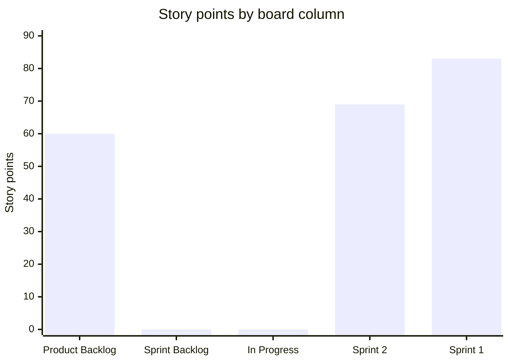
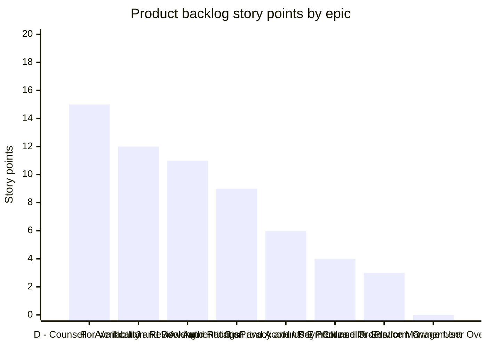
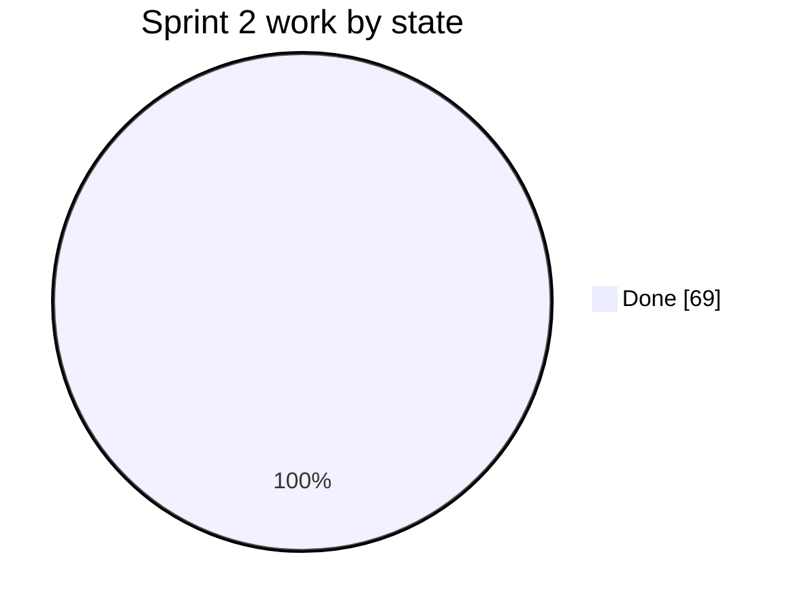
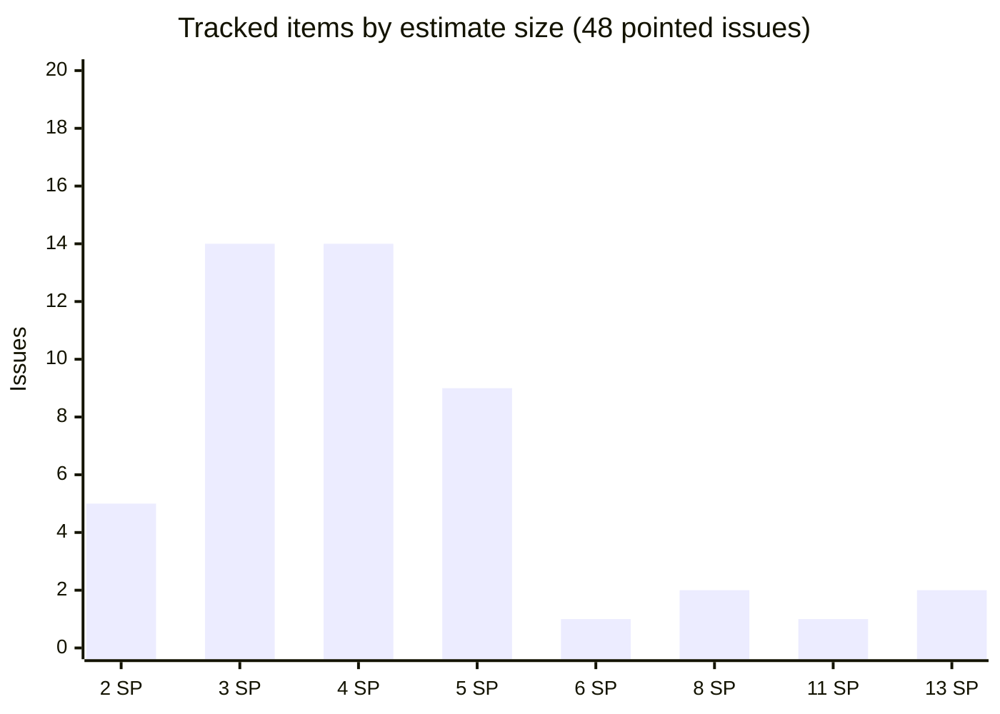
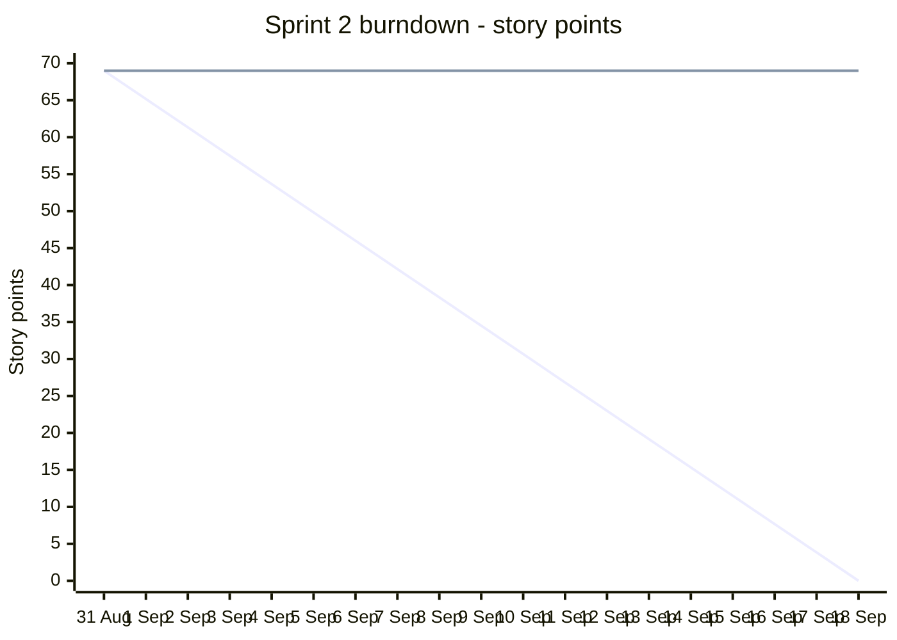
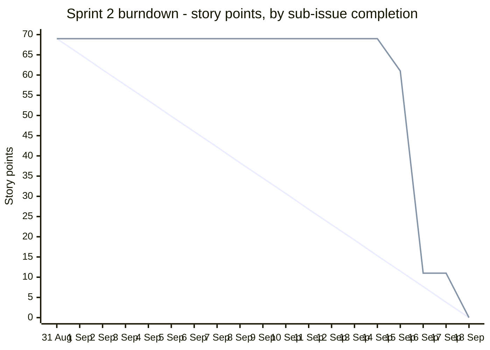

<!--
  Exported from the project wiki. Do not edit here - edit the wiki page and re-export.
  Source page: Process Documentation and Insights
  Source URL:  https://github.com/swen90014-2026-sm2/SWEN90014-2026-CSD-Koala/wiki/Process-Documentation-and-Insights
  Wiki commit: 0b4e79b (2026-09-19)
  Exported:    2026-09-19
  Section 7 is the board insights at the close of Sprint 2, generated with
  .github/scripts/board-insights.py --date 2026-09-18; the wiki page shows the current sprint.
-->

# Process Documentation and Insights

How Team Koala runs the project, updated at the end of Sprint 2. Roles are on [Team Details](https://github.com/swen90014-2026-sm2/SWEN90014-2026-CSD-Koala/wiki/Team-Details) and the records are listed in §6. Sprint 2's plan is on [Sprint 2 Planning](https://github.com/swen90014-2026-sm2/SWEN90014-2026-CSD-Koala/wiki/Sprint-2-Planning) and its outcome on [Sprint 2 Review & Client Feedback](https://github.com/swen90014-2026-sm2/SWEN90014-2026-CSD-Koala/wiki/Sprint-2-Review-and-Client-Feedback); what Sprint 2 taught the team about its process is in §8.

## 1. Ceremonies

| Ceremony | When | Notes |
|---|---|---|
| Stand-up | Weekly, Wednesday 7:00–7:30 pm, Zoom | What you worked on and what you plan for the coming week. Minuted by the Scrum Master. Raise blockers in Slack straight away rather than waiting for the stand-up. |
| Supervisor meeting | Weekly, Thursday 6:30–7:00 pm, Zoom | Erfan observes, the Scrum Master runs it, and each member gives a stand-up update. Minuted. |
| Tutorial and workshop | Friday 3:00–4:00 pm | With tutor Erfan Farabi. Workshops run in the tutorial week (for example on 11 September, on the reuse plan). The workshop in the week of the public holiday moves to Thursday 9:00–10:00 am (agreed 17 September). |
| Client meeting | Once per sprint so far, Microsoft Teams (25 August, 15 September) | Chaired by the Product Owner and Scrum Master; Sprint 2's was a demonstration of the Job Seeker and Career Professional flows. Minutes, transcript and recording go to the client afterwards with Erfan copied, and the Product Owner sends the client a weekly progress email. |
| Internal meeting | Straight after the supervisor session or tutorial | Follow up actions without the supervisor present. Minuted. |
| Sprint planning / review / retrospective | Start and end of each sprint | Recorded on the wiki, for Sprint 2 in [Sprint 2 Planning](https://github.com/swen90014-2026-sm2/SWEN90014-2026-CSD-Koala/wiki/Sprint-2-Planning) and [Sprint 2 Review & Client Feedback](https://github.com/swen90014-2026-sm2/SWEN90014-2026-CSD-Koala/wiki/Sprint-2-Review-and-Client-Feedback). |

## 2. Tracker

All work lives on the [project board](https://github.com/orgs/swen90014-2026-sm2/projects/6) as issues in the repository.

- **Stories** (`[US-nn]`): product backlog items, with Epic, Priority (Must-have / Should-have), Story Points and Sprint iteration. After the client's clarifications the active scope is 43 stories: 129 known SP plus seven still to be estimated (see the [User Story Map](https://github.com/swen90014-2026-sm2/SWEN90014-2026-CSD-Koala/wiki/User-Story-Map)).
- **Story sub-issues** (from Sprint 2): each story taken into a sprint is split into three GitHub sub-issues, `[US-nn] Front-end: …`, `[US-nn] Back-end: …` and `[US-nn] QA: …`. Each has its own Status and assignee, so the three disciplines move and are checked independently. Story Points, Epic and Sprint stay on the parent story. Each owner writes their sub-issue's description and acceptance criteria.
- **Sprint tasks** (`[S1-nn]`): Sprint 1's non-story tasks, with Rubric criterion, Sprint iteration and owners.

**Status flow:** Product Backlog → Sprint Backlog → In Progress → Under Review → Sprint N (done column for that sprint). **Blocked** is used when a task is waiting on something outside the owner's control; name the blocker in a comment. A board automation ties Under Review to the issue's state: moving an item to Under Review closes its issue, and closing an issue moves it to Under Review.

At sprint end, finished items move to that sprint's column and unfinished items roll their Sprint field forward to the next iteration. At the end of Sprint 2 the 20 committed stories and their sub-issues moved to the Sprint 2 column, ordered by story (story, Front-end, Back-end, QA), and US-09–13 moved to the Sprint 3 iteration with their front-end sub-issues In Progress.

## 3. Estimation

Story points are assigned at planning. Sizing guide (from supervisor guidance): ~1 SP ≈ half a day, 2–3 SP ≈ a day or two, 5 SP ≈ two–three days, 8 SP ≈ up to a week. Anything larger is an epic and must be broken down before it enters a sprint.

Only stories carry points; sub-issues are not pointed. Sprint 2 committed 20 stories, 69 SP, each between 2 and 5 SP. US-09–13 are still unestimated and are to be estimated before they are committed in Sprint 3.

## 4. Branching and code workflow

Three levels: `main` → `dev` → feature branches.

| Branch | Purpose | Rule |
|---|---|---|
| `main` | Stable, always runnable. Milestone tags live here (e.g. `v0.1.0-executable-architecture`). | Never push directly. Only `dev` merges in, via PR, after client and QA sign-off (agreed 9 September). |
| `dev` | Integration, where the current sprint's work comes together. Also the team's test environment: a push that changes `backend/` or `frontend/` deploys the API and the Expo web build together to FastAPI Cloud (`deploy-dev.yml`). | Never push directly. Only feature branches merge in, via reviewed PR. |
| `feat/<id>-<name>` | One branch per board item, cut from `dev`. E.g. `feat/S1-04-slot-reservation`. Use `fix/`, `docs/`, `chore/` prefixes for non-feature work. | Deleted after merge. |

Sprint 2 branches drifted from this naming (`feature/sprint2-…`, `backend/…`, `sprint2-qa`); the 9 September stand-up asked for one convention to be used consistently.

### Day-to-day flow

1. Start from a fresh `dev`:
   `git checkout dev && git pull`
2. Branch for your task:
   `git checkout -b feat/S1-04-slot-reservation`
3. Commit as you go, then push the branch:
   `git push -u origin feat/S1-04-slot-reservation`
4. Open a PR **into `dev`**, add reviewers so the whole team sees it, and put `Closes #58` in the description so the board item closes on merge.
5. Review: the other member of your sub-team (frontend: Ariz / James, backend: Evelyn / Jashan) approves; QA (Zhenyang) checks acceptance criteria.
6. Merge, delete the branch, pull `dev` before starting the next task.

### Continuous integration

Every pull request and every push to `dev` runs **Application CI** (`app-ci.yml`):

| Job | What it checks |
|---|---|
| Backend compile, Ruff, PostgreSQL tests and coverage | Lint and the backend test suite against PostgreSQL. |
| Frontend lint, typecheck, coverage, audit and deployable web build | ESLint, TypeScript, Jest with coverage thresholds (90% of statements, functions and lines in `src/api`, `src/auth`, `src/marketplace` and `src/format.ts`), a dependency audit and the web export. |
| Isolated PostgreSQL live HTTPX, TypeScript client and served web build | The real API and the typed client against a throwaway database. |
| Sprint 2 Chromium Web acceptance (isolated API and database) | Playwright journeys in Chromium against a real API and a temporary database. |
| Sprint 2 iOS and Android components | Component tests under the iOS and Android presets (not device end-to-end). |
| Contract, Board and repository evidence | The published API contract and traceability, relative Markdown links, workflow files, QA traceability, and a whitespace check on the whole change. |

Tests for known, recorded defects run separately and are advisory: they report, and do not block a merge. **Mermaid Diagrams** renders the architecture diagrams on each change, and **Board Insights** refreshes §7 daily and when issues change.

## 5. Definition of Ready and Definition of Done

Both are owned by the Product Owner and maintained on the [Product Backlog](https://github.com/swen90014-2026-sm2/SWEN90014-2026-CSD-Koala/wiki/Product-Backlog) page, which is the source of truth for them. They are reproduced here because they gate every item on the board.

**Ready.** A story is ready for implementation when:

- its user role, outcome, priority, and acceptance criteria are agreed;
- frontend and backend teams use the same story ID and behaviour;
- dependencies, authorisation rules, error states, and relevant data are understood;
- any required client decision has been recorded;
- the story is small enough to plan or has been split into independently verifiable work;
- its acceptance tests can be derived without inventing missing product behaviour.

**Done.** A story is done only when:

- its acceptance criteria pass at frontend, backend, and end-to-end levels where applicable;
- backend role, ownership, privacy, and state rules are enforced;
- the frontend represents backend success, failure, and pending states accurately;
- relevant automated and manual tests pass;
- the implementation is peer reviewed and merged;
- the story is demonstrated in sprint review;
- the feature is deployed to the agreed test environment;
- user-facing behaviour works on the agreed target OS(es), supported versions, devices or simulators, and screen-size matrix;
- the shared requirements and traceability records are updated if the delivered behaviour differs from the approved story.

## 6. Records

The wiki is the source for every record. The repository keeps exported copies under `docs/sprint1/` and `docs/sprint2/`, one file per meeting, each with a header naming the wiki page and commit it came from.

- [Daily Standups](https://github.com/swen90014-2026-sm2/SWEN90014-2026-CSD-Koala/wiki/Daily-Standups): the weekly stand-up minutes.
- [Mentor Communication Log](https://github.com/swen90014-2026-sm2/SWEN90014-2026-CSD-Koala/wiki/Mentor-Communication-Log): the weekly supervisor meeting minutes and correspondence with the tutor.
- [Client meeting minutes](https://github.com/swen90014-2026-sm2/SWEN90014-2026-CSD-Koala/wiki/Client-meeting-minutes): every client meeting, with decisions, rationale and owned actions.
- [Sprint 1 Test Approach](https://github.com/swen90014-2026-sm2/SWEN90014-2026-CSD-Koala/wiki/Sprint-1-Test-Approach) and [Sprint 2 Test Approach](https://github.com/swen90014-2026-sm2/SWEN90014-2026-CSD-Koala/wiki/Sprint-2-Test-Approach): the QA strategy, evidence boundaries, database safety rules and results.
- [Sprint 2 Planning](https://github.com/swen90014-2026-sm2/SWEN90014-2026-CSD-Koala/wiki/Sprint-2-Planning) and [Sprint 2 Review & Client Feedback](https://github.com/swen90014-2026-sm2/SWEN90014-2026-CSD-Koala/wiki/Sprint-2-Review-and-Client-Feedback).
- In the repository only: per-story [frontend](https://github.com/swen90014-2026-sm2/SWEN90014-2026-CSD-Koala/tree/dev/docs/sprint2/frontend) and [backend](https://github.com/swen90014-2026-sm2/SWEN90014-2026-CSD-Koala/tree/dev/docs/sprint2/backend) documentation, and [QA evidence](https://github.com/swen90014-2026-sm2/SWEN90014-2026-CSD-Koala/tree/dev/docs/sprint2/qa).

## 7. Board insights

<!-- board-insights:start -->
<!-- Generated by .github/workflows/board-insights.yml. Do not edit this block by hand. -->

_Snapshot of [Project Board 6](https://github.com/orgs/swen90014-2026-sm2/projects/6); source data last updated **18 Sep 2026, 14:15 UTC**._

**138 Issue item(s), 212 story points currently tracked.**

Detected active iteration: **Sprint 2** (31 Aug 2026 to 18 Sep 2026).

> **Data-quality warnings**
> - 90 Issue item(s) have no Story Points value.
> - 76 sprint-flow item(s) have no Sprint iteration value.

### 7.1 Where the work sits

| Column | Issues | Story points | Share of pointed scope |
|---|---:|---:|---:|
| Product Backlog | 18 | 60 | 28% |
| Sprint Backlog | 10 | 0 | 0% |
| In Progress | 10 | 0 | 0% |
| Sprint 2 (Done) | 81 | 69 | 33% |
| Sprint 1 | 19 | 83 | 39% |

**Observed result.** This distribution is a snapshot of the current Status values. It describes where board items are now; it does not prove delivery, acceptance or carry-over.

### 7.2 What the product backlog is made of

| Epic | Stories | Story points |
|---|---:|---:|
| D - Counsellor Verification | 4 | 15 |
| F - Availability and Booking | 3 | 12 |
| J - Reviews and Ratings | 3 | 11 |
| A - Authentication and Accounts | 2 | 9 |
| C - Privacy and User Profiles | 3 | 6 |
| H - Payment and Orders | 1 | 4 |
| E - Counsellor Service Management | 1 | 3 |
| K - Platform Owner User Oversight | 1 | 0 |

**Observed result.** Epic totals include only items currently in the Product Backlog column. Unassigned values remain visible instead of being inferred.

### 7.3 Current sprint state

| State | Issues | Story points |
|---|---:|---:|
| Done | 81 | 69 |
| In Progress | 5 | 0 |
| Sprint Backlog | 10 | 0 |

**Observed result.** 69 of 69 pointed SP are in the **Sprint 2** done column and 0 SP are under review. Board placement is not treated as proof that acceptance criteria passed.

### 7.4 Estimate-size distribution

| Size | Product backlog | Current sprint | All board Issues |
|---|---:|---:|---:|
| 2 SP | 1 | 4 | 5 |
| 3 SP | 4 | 7 | 14 |
| 4 SP | 9 | 5 | 14 |
| 5 SP | 2 | 4 | 9 |
| 6 SP | 0 | 0 | 1 |
| 8 SP | 0 | 0 | 2 |
| 11 SP | 0 | 0 | 1 |
| 13 SP | 0 | 0 | 2 |

**Observed result.** 48 Issue item(s) are pointed and 90 are unpointed. This chart reports the distribution without deciding whether an estimate is appropriately sized.

### 7.5 Current sprint burndown

| Date | Remaining from Issue state (SP) | Ideal from current scope (SP) |
|---|---:|---:|
| 31 Aug 2026 | 69 | 69 |
| 18 Sep 2026 | 69 | 0 |

**Method limitation.** Remaining work uses each Issue's open/closed state and `closedAt`; GitHub's standard ProjectV2 query does not provide historical Status or Story Points transitions. The ideal line uses today's recorded sprint scope. This is an indicative burndown, not a reconstruction of every past board movement.

### 7.6 Data-quality checks

- Closed Issues outside **Sprint 2** (Done): **0**
- Open Issues inside **Sprint 2** (Done): **20**
- Sprint-flow Issues without a Sprint iteration: **76**

These checks expose differences between Issue state and Project fields; they do not silently reconcile or average the two sources.

<!-- board-insights:end -->

## 8. Sprint 2 insights

Observations from the Sprint 2 records, each with its evidence. They are input for the Sprint 2 retrospective, not its outcome; the suggestions are for the team to accept or reject there.

**Sprint 2 in numbers:** 20 stories and 69 SP committed; 11 pull requests merged into `dev`; two stand-ups, two supervisor meetings and one client demonstration minuted; the app deployed to FastAPI Cloud from 9 September.

### 8.1 Sprint 2 burndown at close

The Board Insights burndown for Sprint 2 stays flat at 69 SP: it counts a story as done only when the story's own issue is closed, and the 20 Sprint 2 stories are still open while their acceptance is recorded in the [Sprint 2 Review & Client Feedback](https://github.com/swen90014-2026-sm2/SWEN90014-2026-CSD-Koala/wiki/Sprint-2-Review-and-Client-Feedback). This chart redraws the burndown from the work that was closed: a story counts as finished on the day its last Front-end, Back-end or QA sub-issue closed (Melbourne time). The diagonal is the ideal line.

| Date | Stories finished | SP remaining |
|---|---|---:|
| 31 Aug 2026 | — | 69 |
| 15 Sep 2026 | US-01, US-02, US-03 | 61 |
| 16 Sep 2026 | US-06, US-07, US-08, US-30, US-34, US-35, US-37, US-38, US-39, US-40, US-41, US-44, US-45, US-46 | 11 |
| 18 Sep 2026 | US-04, US-47, US-68 | 0 |

**Reading it.** Sub-issues close when they move to Under Review, so the curve shows when the board recorded each part as finished, not when the code merged and not acceptance. The main pull requests merged on 8, 9, 12 and 14 September, but the board was updated in bulk from 15 to 18 September, which is why the curve drops late. Source: each story's sub-issues and their `closedAt` dates, read from GitHub on 19 September 2026.

### 8.2 Observations

| # | Observation | Evidence | Suggestion for the retrospective |
|---|---|---|---|
| 1 | Re-planning at the weekly stand-up worked. Work was rebalanced mid-sprint instead of waiting for the next sprint. | 9 Sep stand-up: payments (US-47), confirmation (US-68) and email moved to Jashan; Jared kept US-06–08. 10 Sep: Erfan stressed that communication and work distribution matter alongside code, and the team reported clearer board organisation and communication. | Keep rebalancing at the stand-up and record the change on the board the same day. |
| 2 | Splitting stories into Front-end, Back-end and QA sub-issues let each discipline move on its own, but left open when a story counts as done if one part lags. | 16 Sep stand-up: a story whose front-end QA was complete but whose back-end was not could not be moved to Done. | Agree the rule: a story moves to its sprint column when all three sub-issues are done, and its acceptance is recorded in the sprint review. |
| 3 | Integration was concentrated at the end of the sprint. | 5 of the 11 Sprint 2 pull requests merged on 18 September (#155–#159). Application CI failed on four `dev` commits that day, including a lockfile `npm ci` rejected, the API coverage threshold, and acceptance tests expecting the old landing screen; each was fixed the same day. | Merge smaller pull requests through the sprint, and land each feature's tests with it. |
| 4 | The client's feedback arrived at the end of the sprint. | Demonstration on 15 September, written feedback on 17 September; the terminology, profile, branding and diagnosis changes landed on 18 September. | Demonstrate to the client mid-sprint so feedback can be planned rather than absorbed on the last day. |
| 5 | Scope records drifted apart when scope moved. | The wiki placed US-09–13 in Sprint 2 until the Product Owner's 18 September correction; the board's Sprint field still showed Sprint 2 until 19 September. | When scope moves, update the board, the User Story Map and the sprint review together. |
| 6 | The board insights and the sub-issue convention do not fit well. | At the close of Sprint 2 the insights warned about 90 unpointed issues and 76 sprint-flow items without a Sprint iteration, mostly sub-issues, which by design carry neither. All 69 SP sat in the Sprint 2 column, yet the Board Insights burndown stayed at 69 because it counts closed issues and the 20 Sprint 2 stories were still open; §8.1 redraws it from the sub-issues. | Decide whether stories close at acceptance or the burndown counts sub-issues, so the chart shows progress. |
| 7 | Branch and pull-request practice improved but stayed uneven. | 9 Sep stand-up asked everyone to pull `dev` first, add reviewers to every pull request and use one branch-naming convention; Sprint 2 branches still used several patterns. | Check the branch name and reviewers during pull-request review. |
| 8 | Deploying `dev` continuously made integration testing easier, and exposed an environment issue early. | 10 Sep: the deploy pipeline to FastAPI Cloud; 9 Sep: the serverless PostgreSQL instance dropped idle connections after about five minutes. | Keep `dev` deployed; track environment issues on the board like any other defect. |
