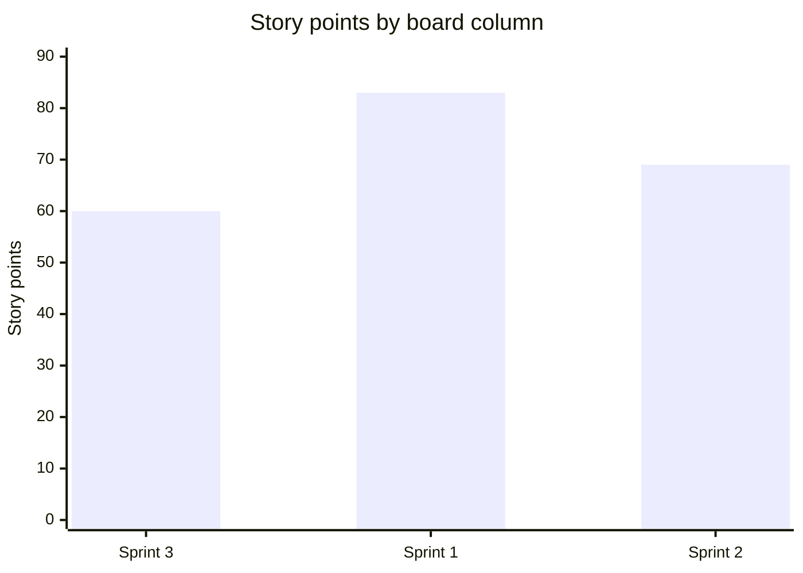
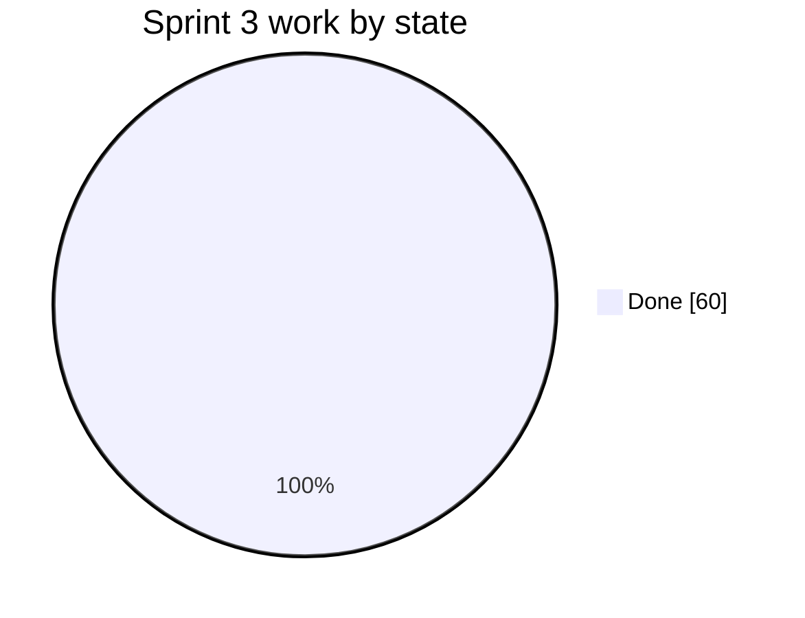
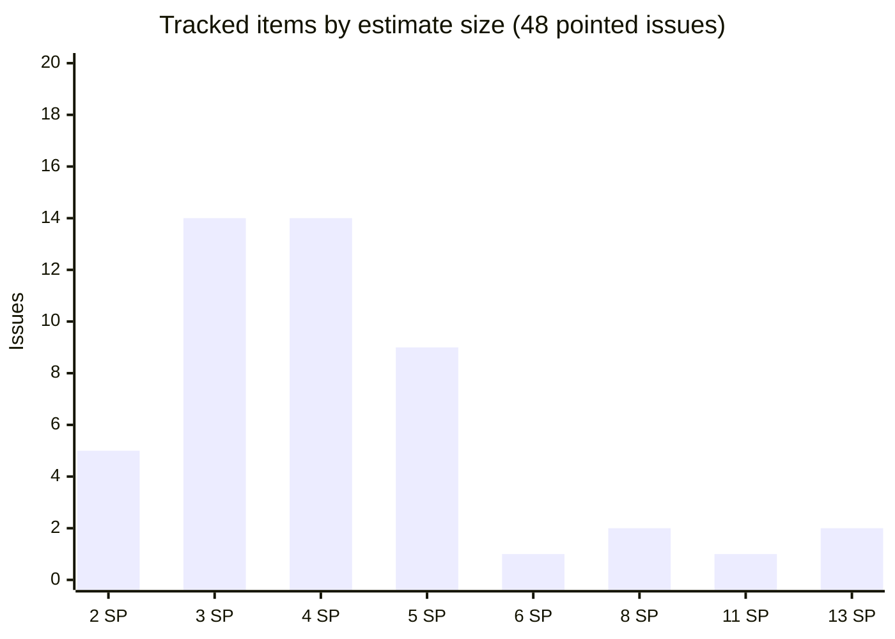
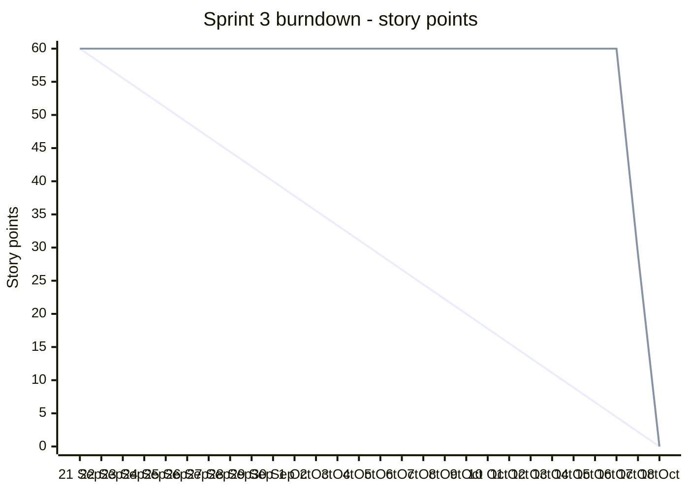
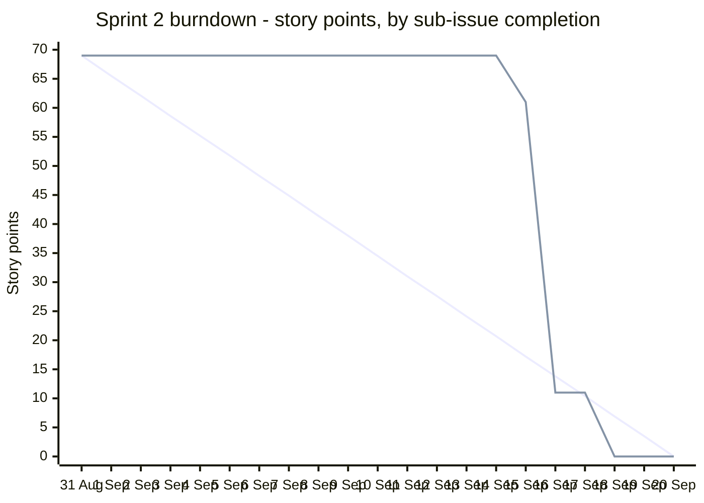
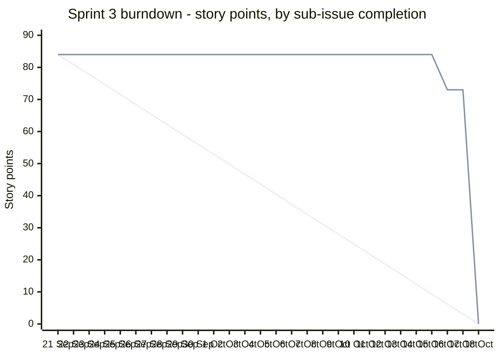

<!--
  Exported from the project wiki. Do not edit here - edit the wiki page and re-export.
  Source page: Process Documentation and Insights
  Source URL:  https://github.com/swen90014-2026-sm2/SWEN90014-2026-CSD-Koala/wiki/Process-Documentation-and-Insights
  Wiki commit: fa8c5fc (2026-10-18)
  Exported:    2026-10-18
-->

# Process Documentation and Insights

How Team Koala runs the project, updated at the end of Sprint 2. Roles are on [Team Details](https://github.com/swen90014-2026-sm2/SWEN90014-2026-CSD-Koala/wiki/Team-Details) and the records are listed in §6. Sprint 2's plan is on [Sprint 2 Planning](https://github.com/swen90014-2026-sm2/SWEN90014-2026-CSD-Koala/wiki/Sprint-2-Planning) and its outcome on [Sprint 2 Review & Client Feedback](https://github.com/swen90014-2026-sm2/SWEN90014-2026-CSD-Koala/wiki/Sprint-2-Review-and-Client-Feedback); what Sprint 2 taught the team about its process is in §8.

At the end of Sprint 3 (18 October 2026) this page gained §9, what Sprint 3 taught the team. Sprint 3's plan is on [Sprint 3 Planning](https://github.com/swen90014-2026-sm2/SWEN90014-2026-CSD-Koala/wiki/Sprint-3-Planning) and its outcome on [Sprint 3 Review & Client Feedback](https://github.com/swen90014-2026-sm2/SWEN90014-2026-CSD-Koala/wiki/Sprint-3-Review-and-Client-Feedback).

## 1. Ceremonies

| Ceremony | When | Notes |
|---|---|---|
| Stand-up | Weekly, Wednesday 7:00–7:30 pm, Zoom | What you worked on and what you plan for the coming week. Minuted by the Scrum Master. Raise blockers in Slack straight away rather than waiting for the stand-up. |
| Supervisor meeting | Weekly, Thursday 6:30–7:00 pm, Zoom | Erfan observes, the Scrum Master runs it, and each member gives a stand-up update. Minuted. |
| Tutorial and workshop | Friday 3:00–4:00 pm | With tutor Erfan Farabi. Workshops run in the tutorial week (for example on 11 September, on the reuse plan). The workshop in the week of the public holiday moves to Thursday 9:00–10:00 am (agreed 17 September). |
| Client meeting | Once per sprint so far, Microsoft Teams (25 August, 15 September, 16 October) | Chaired by the Product Owner and Scrum Master; Sprint 2's was a demonstration of the Job Seeker and Career Professional flows. Minutes, transcript and recording go to the client afterwards with Erfan copied, and the Product Owner sends the client a weekly progress email. |
| Internal meeting | Straight after the supervisor session or tutorial | Follow up actions without the supervisor present. Minuted. |
| Sprint planning / review / retrospective | Start and end of each sprint | Recorded on the wiki, for Sprint 2 in [Sprint 2 Planning](https://github.com/swen90014-2026-sm2/SWEN90014-2026-CSD-Koala/wiki/Sprint-2-Planning) and [Sprint 2 Review & Client Feedback](https://github.com/swen90014-2026-sm2/SWEN90014-2026-CSD-Koala/wiki/Sprint-2-Review-and-Client-Feedback). |

## 2. Tracker

All work lives on the [project board](https://github.com/orgs/swen90014-2026-sm2/projects/6) as issues in the repository.

- **Stories** (`[US-nn]`): product backlog items, with Epic, Priority (Must-have / Should-have), Story Points and Sprint iteration. After the client's clarifications the active scope is 43 stories: 129 known SP plus seven still to be estimated (see the [User Story Map](https://github.com/swen90014-2026-sm2/SWEN90014-2026-CSD-Koala/wiki/User-Story-Map)).
- **Story sub-issues** (from Sprint 2): each story taken into a sprint is split into three GitHub sub-issues, `[US-nn] Front-end: …`, `[US-nn] Back-end: …` and `[US-nn] QA: …`. Each has its own Status and assignee, so the three disciplines move and are checked independently. Story Points, Epic and Sprint stay on the parent story; from the close of Sprint 3 each sub-issue also carries its parent's Sprint and a task estimate (§3). Each owner writes their sub-issue's description and acceptance criteria.
- **Sprint tasks** (`[S1-nn]`): Sprint 1's non-story tasks, with Rubric criterion, Sprint iteration and owners.

**Status flow:** Product Backlog → Sprint Backlog → In Progress → Under Review → Sprint N (done column for that sprint). **Blocked** is used when a task is waiting on something outside the owner's control; name the blocker in a comment. A board automation ties Under Review to the issue's state: moving an item to Under Review closes its issue, and closing an issue moves it to Under Review.

At sprint end, finished items move to that sprint's column and unfinished items roll their Sprint field forward to the next iteration. At the end of Sprint 2 the 20 committed stories and their sub-issues moved to the Sprint 2 column, ordered by story (story, Front-end, Back-end, QA), and US-09–13 moved to the Sprint 3 iteration with their front-end sub-issues In Progress.

At the end of Sprint 3 the 23 committed stories and their sub-issues moved to the Sprint 3 column in the same order, every item in the Sprint 1, Sprint 2 and Sprint 3 columns was closed, and each was moved back from Under Review to its sprint column. The 15 deferred stories (Forum, order-linked messaging and disputes), which were never on the board, were closed as *not planned* (Requirements RR-20).

## 3. Estimation

Story points are assigned at planning. Sizing guide (from supervisor guidance): ~1 SP ≈ half a day, 2–3 SP ≈ a day or two, 5 SP ≈ two–three days, 8 SP ≈ up to a week. Anything larger is an epic and must be broken down before it enters a sprint.

Only stories carry points; sub-issues are not pointed. Sprint 2 committed 20 stories, 69 SP, each between 2 and 5 SP. US-09–13 are still unestimated and are to be estimated before they are committed in Sprint 3.

At the close of Sprint 3 (18 October 2026) every board item was given Story Points and a Sprint. US-09–13, US-29 and US-71 were estimated with the sizing guide from the delivered work: US-09 3, US-10 5, US-11 3, US-12 5, US-13 3, US-29 3 and US-71 2 (24 SP). Each Front-end and Back-end sub-issue was given 40% of its story's points and each QA sub-issue 20%, rounded and at least 1, and the general tasks were estimated against the Sprint 1 tasks. Sub-issue points are task estimates within the story, so Board Insights counts each story's points once and leaves its sub-issues out of the totals and the burndown.

## 4. Branching and code workflow

Three levels: `main` → `dev` → feature branches.

| Branch | Purpose | Rule |
|---|---|---|
| `main` | Stable, always runnable. Milestone tags live here (e.g. `v0.1.0-executable-architecture`). | Never push directly. Only `dev` merges in, via PR, after client and QA sign-off (agreed 9 September). |
| `dev` | Integration, where the current sprint's work comes together. Also the team's test environment: a push that changes `backend/` or `frontend/` deploys the API and the Expo web build together to FastAPI Cloud (`deploy-dev.yml`). | Never push directly. Only feature branches merge in, via reviewed PR. |
| `feat/<id>-<name>` | One branch per board item, cut from `dev`. E.g. `feat/S1-04-slot-reservation`. Use `fix/`, `docs/`, `chore/` prefixes for non-feature work. | Deleted after merge. |

Sprint 2 branches drifted from this naming (`feature/sprint2-…`, `backend/…`, `sprint2-qa`); the 9 September stand-up asked for one convention to be used consistently.

### Day-to-day flow

1. Start from a fresh `dev`:
   `git checkout dev && git pull`
2. Branch for your task:
   `git checkout -b feat/S1-04-slot-reservation`
3. Commit as you go, then push the branch:
   `git push -u origin feat/S1-04-slot-reservation`
4. Open a PR **into `dev`**, add reviewers so the whole team sees it, and put `Closes #58` in the description so the board item closes on merge.
5. Review: the other member of your sub-team (frontend: Ariz / James, backend: Evelyn / Jashan) approves; QA (Zhenyang) checks acceptance criteria.
6. Merge, delete the branch, pull `dev` before starting the next task.

### Continuous integration

Every pull request and every push to `dev` runs **Application CI** (`app-ci.yml`):

| Job | What it checks |
|---|---|
| Backend compile, Ruff, PostgreSQL tests and coverage | Lint and the backend test suite against PostgreSQL. |
| Frontend lint, typecheck, coverage, audit and deployable web build | ESLint, TypeScript, Jest with coverage thresholds (90% of statements, functions and lines in `src/api`, `src/auth`, `src/marketplace` and `src/format.ts`), a dependency audit and the web export. |
| Isolated PostgreSQL live HTTPX, TypeScript client and served web build | The real API and the typed client against a throwaway database. |
| Sprint 2 Chromium Web acceptance (isolated API and database) | Playwright journeys in Chromium against a real API and a temporary database. |
| Sprint 2 iOS and Android components | Component tests under the iOS and Android presets (not device end-to-end). |
| Contract, Board and repository evidence | The published API contract and traceability, relative Markdown links, workflow files, QA traceability, and a whitespace check on the whole change. |

Tests for known, recorded defects run separately and are advisory: they report, and do not block a merge. **Mermaid Diagrams** renders the architecture diagrams on each change, and **Board Insights** refreshes §7 daily and when issues change.

## 5. Definition of Ready and Definition of Done

Both are owned by the Product Owner and maintained on the [Product Backlog](https://github.com/swen90014-2026-sm2/SWEN90014-2026-CSD-Koala/wiki/Product-Backlog) page, which is the source of truth for them. They are reproduced here because they gate every item on the board.

**Ready.** A story is ready for implementation when:

- its user role, outcome, priority, and acceptance criteria are agreed;
- frontend and backend teams use the same story ID and behaviour;
- dependencies, authorisation rules, error states, and relevant data are understood;
- any required client decision has been recorded;
- the story is small enough to plan or has been split into independently verifiable work;
- its acceptance tests can be derived without inventing missing product behaviour.

**Done.** A story is done only when:

- its acceptance criteria pass at frontend, backend, and end-to-end levels where applicable;
- backend role, ownership, privacy, and state rules are enforced;
- the frontend represents backend success, failure, and pending states accurately;
- relevant automated and manual tests pass;
- the implementation is peer reviewed and merged;
- the story is demonstrated in sprint review;
- the feature is deployed to the agreed test environment;
- user-facing behaviour works on the agreed target OS(es), supported versions, devices or simulators, and screen-size matrix;
- the shared requirements and traceability records are updated if the delivered behaviour differs from the approved story.

## 6. Records

The wiki is the source for every record. The repository keeps exported copies under `docs/sprint1/` and `docs/sprint2/`, one file per meeting, each with a header naming the wiki page and commit it came from.

From Sprint 3 the exported copies are under `docs/sprint3/`: the meeting minutes, [Sprint 3 Planning](https://github.com/swen90014-2026-sm2/SWEN90014-2026-CSD-Koala/wiki/Sprint-3-Planning), [Sprint 3 Review & Client Feedback](https://github.com/swen90014-2026-sm2/SWEN90014-2026-CSD-Koala/wiki/Sprint-3-Review-and-Client-Feedback), the [Sprint 3 Retrospective](https://github.com/swen90014-2026-sm2/SWEN90014-2026-CSD-Koala/wiki/Sprint-3-Retrospective), this page, the [Requirements](https://github.com/swen90014-2026-sm2/SWEN90014-2026-CSD-Koala/wiki/Requirements), the [Product Backlog](https://github.com/swen90014-2026-sm2/SWEN90014-2026-CSD-Koala/wiki/Product-Backlog), the [Risk Register](https://github.com/swen90014-2026-sm2/SWEN90014-2026-CSD-Koala/wiki/Risk-Register) with its Sprint 3 review, and the [Sprint 3 Feature Walkthrough](https://github.com/swen90014-2026-sm2/SWEN90014-2026-CSD-Koala/wiki/Sprint-3-Feature-Walkthrough) with its [desktop version](https://github.com/swen90014-2026-sm2/SWEN90014-2026-CSD-Koala/wiki/Sprint-3-Feature-Walkthrough-Desktop).

- [Daily Standups](https://github.com/swen90014-2026-sm2/SWEN90014-2026-CSD-Koala/wiki/Daily-Standups): the weekly stand-up minutes.
- [Mentor Communication Log](https://github.com/swen90014-2026-sm2/SWEN90014-2026-CSD-Koala/wiki/Mentor-Communication-Log): the weekly supervisor meeting minutes and correspondence with the tutor.
- [Client meeting minutes](https://github.com/swen90014-2026-sm2/SWEN90014-2026-CSD-Koala/wiki/Client-meeting-minutes): every client meeting, with decisions, rationale and owned actions.
- [Sprint 1 Test Approach](https://github.com/swen90014-2026-sm2/SWEN90014-2026-CSD-Koala/wiki/Sprint-1-Test-Approach) and [Sprint 2 Test Approach](https://github.com/swen90014-2026-sm2/SWEN90014-2026-CSD-Koala/wiki/Sprint-2-Test-Approach): the QA strategy, evidence boundaries, database safety rules and results.
- [Sprint 2 Planning](https://github.com/swen90014-2026-sm2/SWEN90014-2026-CSD-Koala/wiki/Sprint-2-Planning) and [Sprint 2 Review & Client Feedback](https://github.com/swen90014-2026-sm2/SWEN90014-2026-CSD-Koala/wiki/Sprint-2-Review-and-Client-Feedback).
- In the repository only: per-story [frontend](https://github.com/swen90014-2026-sm2/SWEN90014-2026-CSD-Koala/tree/dev/docs/sprint2/frontend) and [backend](https://github.com/swen90014-2026-sm2/SWEN90014-2026-CSD-Koala/tree/dev/docs/sprint2/backend) documentation, and [QA evidence](https://github.com/swen90014-2026-sm2/SWEN90014-2026-CSD-Koala/tree/dev/docs/sprint2/qa).

## 7. Board insights

<!-- board-insights:start -->
<!-- Generated by .github/workflows/board-insights.yml. Do not edit this block by hand. -->

_Snapshot of [Project Board 6](https://github.com/orgs/swen90014-2026-sm2/projects/6); source data last updated **18 Oct 2026, 01:38 UTC**._

**193 Issue item(s), 212 story points currently tracked.**

Detected active iteration: **Sprint 3** (21 Sep 2026 to 18 Oct 2026).

> **Data-quality warnings**
> - 145 Issue item(s) have no Story Points value.
> - 70 sprint-flow item(s) have no Sprint iteration value.

### 7.1 Where the work sits

| Column | Issues | Story points | Share of pointed scope |
|---|---:|---:|---:|
| Sprint 3 (Done) | 93 | 60 | 28% |
| Sprint 1 | 19 | 83 | 39% |
| Sprint 2 | 81 | 69 | 33% |

**Observed result.** This distribution is a snapshot of the current Status values. It describes where board items are now; it does not prove delivery, acceptance or carry-over.

### 7.2 What the product backlog is made of

_No pointed items are available for this chart._

| Epic | Stories | Story points |
|---|---:|---:|
| No product-backlog epic data | 0 | 0 |

**Observed result.** Epic totals include only items currently in the Product Backlog column. Unassigned values remain visible instead of being inferred.

### 7.3 Current sprint state

| State | Issues | Story points |
|---|---:|---:|
| Done | 93 | 60 |

**Observed result.** 60 of 60 pointed SP are in the **Sprint 3** done column and 0 SP are under review. Board placement is not treated as proof that acceptance criteria passed.

### 7.4 Estimate-size distribution

| Size | Product backlog | Current sprint | All board Issues |
|---|---:|---:|---:|
| 2 SP | 0 | 1 | 5 |
| 3 SP | 0 | 4 | 14 |
| 4 SP | 0 | 9 | 14 |
| 5 SP | 0 | 2 | 9 |
| 6 SP | 0 | 0 | 1 |
| 8 SP | 0 | 0 | 2 |
| 11 SP | 0 | 0 | 1 |
| 13 SP | 0 | 0 | 2 |

**Observed result.** 48 Issue item(s) are pointed and 145 are unpointed. This chart reports the distribution without deciding whether an estimate is appropriately sized.

### 7.5 Current sprint burndown

| Date | Remaining from Issue state (SP) | Ideal from current scope (SP) |
|---|---:|---:|
| 21 Sep 2026 | 60 | 60 |
| 18 Oct 2026 | 0 | 0 |

**Method limitation.** Remaining work uses each Issue's open/closed state and `closedAt`; GitHub's standard ProjectV2 query does not provide historical Status or Story Points transitions. The ideal line uses today's recorded sprint scope. This is an indicative burndown, not a reconstruction of every past board movement.

### 7.6 Data-quality checks

- Closed Issues outside **Sprint 3** (Done): **0**
- Open Issues inside **Sprint 3** (Done): **0**
- Sprint-flow Issues without a Sprint iteration: **70**

These checks expose differences between Issue state and Project fields; they do not silently reconcile or average the two sources.

<!-- board-insights:end -->

## 8. Sprint 2 insights

Observations from the Sprint 2 records, each with its evidence. They are input for the Sprint 2 retrospective, not its outcome; the suggestions are for the team to accept or reject there.

**Sprint 2 in numbers:** 20 stories and 69 SP committed; 11 pull requests merged into `dev`; two stand-ups, two supervisor meetings and one client demonstration minuted; the app deployed to FastAPI Cloud from 9 September.

### 8.1 Sprint 2 burndown at close

The Board Insights burndown for Sprint 2 stays flat at 69 SP: it counts a story as done only when the story's own issue is closed, and the 20 Sprint 2 stories are still open while their acceptance is recorded in the [Sprint 2 Review & Client Feedback](https://github.com/swen90014-2026-sm2/SWEN90014-2026-CSD-Koala/wiki/Sprint-2-Review-and-Client-Feedback). This chart redraws the burndown from the work that was closed: a story counts as finished on the day its last Front-end, Back-end or QA sub-issue closed (Melbourne time). The diagonal is the ideal line.

| Date | Stories finished | SP remaining |
|---|---|---:|
| 31 Aug 2026 | — | 69 |
| 15 Sep 2026 | US-01, US-02, US-03 | 61 |
| 16 Sep 2026 | US-06, US-07, US-08, US-30, US-34, US-35, US-37, US-38, US-39, US-40, US-41, US-44, US-45, US-46 | 11 |
| 18 Sep 2026 | US-04, US-47, US-68 | 0 |

**Reading it.** Sub-issues close when they move to Under Review, so the curve shows when the board recorded each part as finished, not when the code merged and not acceptance. The main pull requests merged on 8, 9, 12 and 14 September, but the board was updated in bulk from 15 to 18 September, which is why the curve drops late. Source: each story's sub-issues and their `closedAt` dates, read from GitHub on 19 September 2026.

### 8.2 Observations

| # | Observation | Evidence | Suggestion for the retrospective |
|---|---|---|---|
| 1 | Re-planning at the weekly stand-up worked. Work was rebalanced mid-sprint instead of waiting for the next sprint. | 9 Sep stand-up: payments (US-47), confirmation (US-68) and email moved to Jashan; Jared kept US-06–08. 10 Sep: Erfan stressed that communication and work distribution matter alongside code, and the team reported clearer board organisation and communication. | Keep rebalancing at the stand-up and record the change on the board the same day. |
| 2 | Splitting stories into Front-end, Back-end and QA sub-issues let each discipline move on its own, but left open when a story counts as done if one part lags. | 16 Sep stand-up: a story whose front-end QA was complete but whose back-end was not could not be moved to Done. | Agree the rule: a story moves to its sprint column when all three sub-issues are done, and its acceptance is recorded in the sprint review. |
| 3 | Integration was concentrated at the end of the sprint. | 5 of the 11 Sprint 2 pull requests merged on 18 September (#155–#159). Application CI failed on four `dev` commits that day, including a lockfile `npm ci` rejected, the API coverage threshold, and acceptance tests expecting the old landing screen; each was fixed the same day. | Merge smaller pull requests through the sprint, and land each feature's tests with it. |
| 4 | The client's feedback arrived at the end of the sprint. | Demonstration on 15 September, written feedback on 17 September; the terminology, profile, branding and diagnosis changes landed on 18 September. | Demonstrate to the client mid-sprint so feedback can be planned rather than absorbed on the last day. |
| 5 | Scope records drifted apart when scope moved. | The wiki placed US-09–13 in Sprint 2 until the Product Owner's 18 September correction; the board's Sprint field still showed Sprint 2 until 19 September. | When scope moves, update the board, the User Story Map and the sprint review together. |
| 6 | The board insights and the sub-issue convention do not fit well. | At the close of Sprint 2 the insights warned about 90 unpointed issues and 76 sprint-flow items without a Sprint iteration, mostly sub-issues, which by design carry neither. All 69 SP sat in the Sprint 2 column, yet the Board Insights burndown stayed at 69 because it counts closed issues and the 20 Sprint 2 stories were still open; §8.1 redraws it from the sub-issues. | Decide whether stories close at acceptance or the burndown counts sub-issues, so the chart shows progress. |
| 7 | Branch and pull-request practice improved but stayed uneven. | 9 Sep stand-up asked everyone to pull `dev` first, add reviewers to every pull request and use one branch-naming convention; Sprint 2 branches still used several patterns. | Check the branch name and reviewers during pull-request review. |
| 8 | Deploying `dev` continuously made integration testing easier, and exposed an environment issue early. | 10 Sep: the deploy pipeline to FastAPI Cloud; 9 Sep: the serverless PostgreSQL instance dropped idle connections after about five minutes. | Keep `dev` deployed; track environment issues on the board like any other defect. |

## 9. Sprint 3 insights

Observations from the Sprint 3 records, each with its evidence. The suggestions are for the team to accept or reject; the [Sprint 3 Retrospective](https://github.com/swen90014-2026-sm2/SWEN90014-2026-CSD-Koala/wiki/Sprint-3-Retrospective) on 18 October records what the team itself discussed.

**Sprint 3 in numbers:** 23 stories committed, 84 SP: 16 estimated at planning (60 SP) and seven (US-09–13, US-29, US-71; 24 SP) estimated only at sprint close; 14 pull requests merged into `dev`, 12 of them in the last week, plus 10 code and test commits pushed to `dev` directly; the Sprint 2 retrospective and Sprint 3 planning (7 October), one supervisor meeting, one stand-up and one client demonstration minuted; `dev` deployed to FastAPI Cloud on every code push (26 deployments, all successful); 23 QA tasks closed with evidence; 15 deferred stories closed as not planned on 18 October.

### 9.1 Sprint 3 burndown at close

The Board Insights burndown in §7.5 counts a story as done when the story's own issue closes, and all 23 Sprint 3 story issues were closed on 18 October. This chart redraws the burndown the same way as §8.1: a story counts as finished on the day its last Front-end, Back-end or QA sub-issue closed (Melbourne time). The diagonal is the ideal line. The chart covers all 84 SP, including the 24 SP of US-09–13, US-29 and US-71, which were estimated at sprint close.

| Date | Stories finished | SP remaining |
|---|---|---:|
| 21 Sep 2026 | — | 84 |
| 16 Oct 2026 | US-09, US-10, US-11 | 73 |
| 18 Oct 2026 | US-05, US-12, US-13, US-27, US-28, US-29, US-31, US-32, US-33, US-36, US-42, US-43, US-48, US-53, US-54, US-55, US-58, US-69, US-70, US-71 | 0 |

**Reading it.** The curve stays flat for 27 days and drops to zero on the last one. That drop records a tidy-up of the board more than the work itself. The front-end sub-issues were closed as their code merged, between 5 and 8 October. The 23 QA sub-issues were closed within two minutes on 16 October, as the QA pull request (#241) was opened. On 18 October, between 10:43 and 11:21, Manu closed 18 of the 23 back-end sub-issues and 12 story issues while tidying the board, and Evelyn closed the US-05 and US-36 back-end sub-issues and the other 11 stories. No sub-issue was closed by a pull request. The code reached `dev` earlier. The back ends for US-05, US-42, US-43, US-69 and US-70 came with their front-end commits on 6–8 October; US-09–11 merged in #233 (12 Oct), US-31–33 in #235 (13 Oct), US-48 and US-58 in #238 and US-53–55 in #239 (14 Oct), US-12 and US-13 in #236 (15 Oct), and US-27–29 in #237 (16 Oct). US-36 was finished by the fixes in #243, #244 and #246, and the diagnosis was connected end to end in #242, all on 17 October. Counted by those merge dates, 21 SP of the 60 SP estimated at planning were on `dev` by 8 October, 51 SP by 14 October and all 60 SP by 17 October: most of the work landed in the sprint's last week, but days before the board recorded it. Only the US-09–11 back-end sub-issues were closed near their merge, on 14 October. Source: each story's sub-issues, their `closedAt` dates and close events, and the pull requests and commits merged into `dev`, read from GitHub on 18 October 2026.

### 9.2 Observations

| # | Observation | Evidence | Suggestion for the retrospective |
|---|---|---|---|
| 1 | Planning and the first merges came halfway through the sprint. | The iteration opened on 21 Sep, but nothing merged into `dev` until 5 Oct (#232), day 15 of 28, and no meeting was minuted between 17 Sep and 7 Oct. The Sprint 2 retrospective and Sprint 3 planning were held on 7 Oct with 11 of 28 days left. | Plan on the first day of the sprint, so the work starts with owners and estimates in place. |
| 2 | The back end lagged the front end, and integration bunched up in the last week again (Sprint 2 observation 3). | 7 Oct planning: "the front end is well ahead of the back end"; the front-end sub-issues closed 5–8 Oct. 8 Oct supervisor meeting: the US-09–11 back end was to merge that night and the admin endpoint pull requests to be raised by 9 Oct; they merged on 12 Oct (#233) and 14 Oct (#238). 14 Oct stand-up: Evelyn was waiting for Jashan's consolidated pull request for US-53, US-54 and US-55 before continuing US-54 and US-55; it merged that evening as #239, 21 minutes after it was opened. 12 of the 14 pull requests merged from 12 to 17 Oct, five of them on 17 Oct (#241–#244, #246), including the end-to-end diagnosis (#242) after the plan's 16 Oct cut-off for features. | Start each story's back end with its front end, and merge in small pieces instead of one consolidated branch. |
| 3 | The board was updated in bulk at the end again, the pattern behind Sprint 2 observations 3 and 6. | §9.1: the 23 QA sub-issues closed within two minutes on 16 Oct; 20 back-end sub-issues and all 23 stories closed on 18 Oct between 10:43 and 11:21, days after their code merged. No sub-issue was closed by its pull request. Sprint 3 Planning §6 had added the rule that cards move when the work moves, "never in a bulk update at the end". | Put `Closes #nnn` for the sub-issue in each pull request, so the board moves when the code merges, and check the board at each stand-up. |
| 4 | Seven stories were estimated only at sprint close, so the top-priority feature was missing from the burndown for the whole sprint. | US-09–13, US-29 and US-71 had no story points until the board was completed on 18 Oct (A3, due 9 Oct). The diagnosis (US-09–13) is the first Sprint 3 priority (RR-09), but until then it added nothing to the sprint's points. Until 18 Oct Board Insights warned of 145 issues without story points and 69 sprint-flow items without a Sprint iteration, nearly all of them sub-issues; both were cleared that day (§3). | Estimate every story before it enters a sprint. Either point the sub-issues as Sprint 3 Planning §6 asked, or drop that rule. |
| 5 | The diagnosis rules are still not confirmed by the client. | RR-13 and RR-14, raised on 18 Sep, are still open in [Requirements](https://github.com/swen90014-2026-sm2/SWEN90014-2026-CSD-Koala/wiki/Requirements) §8.2; A5 (due 11 Oct) is still open. 16 Oct client meeting: Sam called the diagnosis "the heart and soul" of the app and is rewriting the questions himself. It was not shown live: the demo account had already completed it, and its front and back end were not yet connected (#242, 17 Oct). The [Risk Register](https://github.com/swen90014-2026-sm2/SWEN90014-2026-CSD-Koala/wiki/Risk-Register) rates this High likelihood and High impact (R-06). | Get Sam's revised questions in writing and confirm the rules before the 23 Oct acceptance session; list anything not changed in time as a known limitation in the handover. |
| 6 | The client saw the work only at the end of the sprint again. | Sprint 2 suggested a mid-sprint demonstration (§8.2, observation 4; R5). Sprint 3's only client meeting was on 16 Oct, two days before close and a month after the previous one (15 Sep). Log-in and screen-sharing problems slowed the demo, and Sam's feedback is due by email over 17–18 Oct, after the sprint. | Before the 23 Oct acceptance session, rehearse on the deployed link with a fresh Job Seeker account, so the diagnosis can be shown, and test screen sharing. |
| 7 | The scope cut reached GitHub only at the close. | The Forum (US-14–22), order-linked messaging (US-49, US-50, US-62, US-63) and after-sales (US-51, US-52) stories were deferred on 18 Sep (RR-08), but their 15 issues stayed open until 18 Oct, when they were closed as not planned within half a minute. They were not targeted this semester because their priority was low relative to their story points and the team's capacity (RR-20, [Product Backlog](https://github.com/swen90014-2026-sm2/SWEN90014-2026-CSD-Koala/wiki/Product-Backlog)). | When scope is cut, close or relabel the issues the same day (R6). List the deferred stories in the handover so a later team can restore them. |
| 8 | The desktop web layout was added the day before the sprint closed, outside the committed stories. | Commit `bad7a8b` on 17 Oct at 18:00 changed 49 files (+4,207 and −906 lines) and went to `dev` without a pull request; its board item (#245) was created and closed in the same minute and has no estimate. The plan allowed no feature merges after 16 Oct. QA re-ran the desktop and phone browser suites against it that evening and recorded two new accessibility findings (`DEF-REGISTER-WEB-CHECKED`, `DEF-DESKTOP-NAV-CURRENT`). | Put late work on the board with an estimate before starting it, and send it through a pull request like any other change. |
| 9 | Pull-request practice stayed uneven. | 7 of the 14 pull requests merged with no review on GitHub (#232, #234, #236, #238, #239, #240, #243); #238–#240 were opened and merged by their author within 4 to 21 minutes on 14 Oct. Ten code and test commits went to `dev` without a pull request: the US-05, US-29, US-42, US-43, US-69 and US-70 changes (6–8 Oct), three CI fixes and the desktop layout (17 Oct). On 17 Oct a fix pushed straight to `dev` was reverted and removed with a force-push, then raised as #244. Branch names used five patterns, and 7 of the 14 named a story. | Protect `dev`: require a pull request with one approval and a passing Application CI, and block force-pushes. Set the same rule on the client's repository at handover. |
| 10 | CI on `dev` held up through the late merges. | 33 Application CI runs on `dev` from 5 to 17 Oct: 28 passed, 4 failed and 1 was cancelled by a newer push. A browser test still expected the old publishing flow after US-05 (6 Oct, fixed that night); Ruff rejected test code on 7 and 8 Oct (fixed within 15 minutes and three hours); on 14 Oct (#240) the evidence upload timed out after 749 backend tests had passed. All five 17 Oct merges passed, against four failed `dev` commits on the last day of Sprint 2. The deploy to FastAPI Cloud does not wait for CI, so the failing commits were deployed too. | Keep fixing a red `dev` before new work. Make the deploy run only after Application CI passes. |
| 11 | QA was thorough and caught real defects before the close, but it came late and its evidence is hard to navigate. | 14 Oct stand-up: Zhenyang was waiting for the remaining features before the final tests. PR #241 (16–17 Oct) maps all 23 QA tasks to executed cases: 610 shared and 619 iOS and Android component tests passed, 916 backend tests passed with 18 strict expected failures, and the 44 browser cases per project have passing evidence. QA findings were fixed the same day: the meeting area (`S3-BE-SERVICE-HISTORY`, #244) and the confirmation screen (`S3-CONFIRMATION-AREA`, #246), both 17 Oct. `docs/sprint3/qa` holds 1,547 files (79 MB), against 127 files (6.3 MB) for Sprint 2, with ten dated reports and ten evidence folders from 14–17 Oct. | Keep the find-and-fix loop. For the handover, keep one current report and move the dated ones into an archive (A10). |

### 9.3 Sprint 2 retrospective actions — how they went

Sprint 3 Planning §6 added three rules and §8 listed eleven actions (A1–A11), drawn from the [Sprint 2 Retrospective](https://github.com/swen90014-2026-sm2/SWEN90014-2026-CSD-Koala/wiki/Sprint-2-Retrospective) actions. Each is checked against the records on 18 October. R3, R6 and R9 are listed separately because the planning page does not restate them.

| Action | Outcome | Evidence |
|---|---|---|
| Rule: a story closes when it is done | Partly | All 23 story issues were closed, but together on 18 Oct (§9.1), not as each was done, and before the Sprint 3 review and the client's acceptance session (23 Oct). |
| Rule: every sub-issue has points, an owner and the Sprint 3 iteration | Done late | All 69 sub-issues had an owner by 15 Oct; story points and the Sprint iteration were added to every sub-issue on 18 Oct (§3). |
| Rule: cards move when the work moves | Not done | Front-end sub-issues moved with their merges (5–8 Oct); the QA sub-issues were closed in two minutes on 16 Oct, and 20 back-end sub-issues and all stories on 18 Oct. |
| A1 Assign the 10 unowned back-end sub-issues (9 Oct) | Done late | Four assigned on 8 Oct (US-43, US-54, US-55, US-69 to Evelyn), four on 14 Oct (US-12, US-27, US-28, US-29 to Jared), two on 15 Oct (US-05, US-13 to Evelyn). |
| A2 Assign the 18 QA sub-issues, point every sub-issue, set the iteration (9 Oct) | Done late | The 18 QA sub-issues were assigned to Zhenyang on 14 Oct; every sub-issue was pointed and given the Sprint iteration on 18 Oct. |
| A3 Estimate US-09–13, US-29 and US-71 (9 Oct) | Done late | Estimated at sprint close on 18 Oct: 24 SP in all (§3). |
| A4 Review and merge PR #233 (10 Oct) | Done late | Approved by Evelyn and merged on 12 Oct. |
| A5 Agree the diagnosis rules with the client (11 Oct) | Not done | RR-13 and RR-14 still open; on 16 Oct Sam said he is rewriting the questions (R-06). |
| A6 Client demonstration before the sprint closes | Partly | Held on 16 Oct, but the diagnosis was not shown live and was not yet connected to its back end (#242, 17 Oct). |
| A7 Merge the back ends and close each story once its QA evidence is recorded (16 Oct) | Partly | Back-end pull requests merged 12–16 Oct, with the diagnosis connection and the US-36 fixes on 17 Oct (#242–#244, #246); QA evidence recorded 16–17 Oct (#241); stories closed on 18 Oct. |
| A8 Update the design concept, schema and reuse-plan status (16 Oct) | Done late | Updated on 8 Oct (`f6db563`), then again on 18 Oct after the back-end merges: the diagram, the reuse-plan status and the schema document now show the diagnosis, reviews and reschedule as built (`6a235c6`). |
| A9 Traceability status column and README operation count (16 Oct) | Done late | Both on 18 Oct (`d24a9ae`). |
| A10 Tag the build, record CI on the tag, one current test-results page (18 Oct) | Partly | The QA README and the Sprint 3 Test Approach name one current report (`test-results-confirmation-20261017.md`), but the nine earlier reports sit beside it, and the build is not tagged. |
| A11 Minute every meeting on the day; retrospective before close | Partly | The 16 Oct client meeting was minuted the same day; the 8 Oct supervisor meeting on 13 Oct and the 14 Oct stand-up on 18 Oct. The 15 Oct supervisor meeting was minuted on 18 Oct. The [Sprint 3 Retrospective](https://github.com/swen90014-2026-sm2/SWEN90014-2026-CSD-Koala/wiki/Sprint-3-Retrospective) was held on 18 Oct, the day the sprint closed. |
| R3 Small pull requests, branch names, a reviewer on every pull request | Partly | 7 of 14 pull requests had no review, 10 code and test commits went to `dev` directly, and no branch used the agreed `feature/US-xx-short-name` form (§9.2, observation 9). |
| R6 Update scope records together when scope moves | Partly | The 18 Sep deferral reached GitHub only on 18 Oct; the Requirements and Product Backlog were updated the same day (§9.2, observation 7). |
| R9 Track environment issues on the board | Not done | No board issue for the database connection drops; the Risk Register still lists them on 18 Oct (R-09). |
